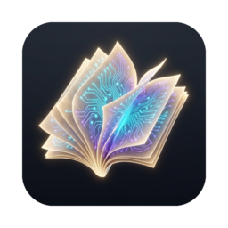
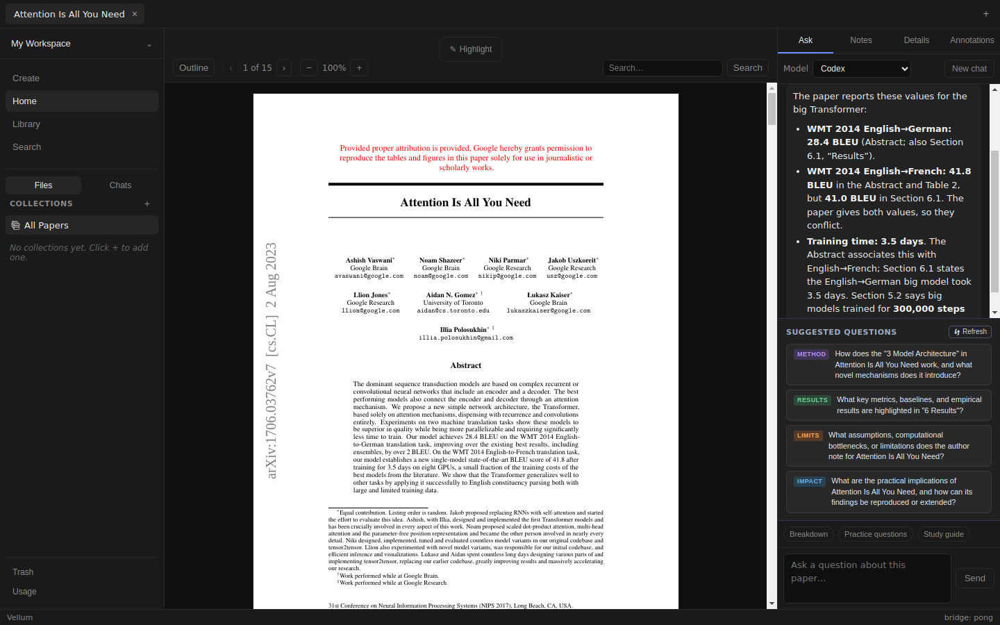

<p align="center"></p>

# Vellum

A local-first desktop workspace for reading research papers, asking about difficult passages, and keeping notes and highlights with the paper. AI uses your existing signed-in Codex or Claude plan through ACP adapters. No separate Vellum account or raw API key.

## Beta download

**v0.1.1-beta.1 · Apple Silicon Macs · MIT license**

[Download the Mac beta](https://github.com/dkritarth/Vellum/releases/tag/v0.1.1-beta.1) · [Website](https://dkritarth.com/Vellum/) · [Release notes](docs/releases/v0.1.1-beta.1.md)

Open the DMG and move Vellum to Applications. This beta is ad-hoc signed, not Apple-notarized. If macOS blocks it, review [Apple's first-launch guidance](https://support.apple.com/en-us/102445). There is no Intel Mac download for this beta.

## Watch the workflow

[](https://dkritarth.com/Vellum/#walkthrough)

- [Part 1: import, read, select, Ask/Explain, highlights, notes, collections, and usage](docs/evidence/daily-workflow-2026-11-16/walkthrough-1.webm)
- [Part 2: restart persistence, conversation deletion, note clearing, and purge](docs/evidence/daily-workflow-2026-11-16/walkthrough-2.webm)
- [Timestamped coverage and limitations](docs/verification/daily-workflow-2026-11-16.md)

Both videos show the actual Electron app with real papers and signed-in Codex. All 27 chapters pass. Recordings were made on Linux; they do not certify physical Mac input behavior or every backend.

## What you can do

Import a local PDF, arXiv ID, DOI, or PDF URL. Read continuous pages, search, zoom, and follow resolvable references. Select text to add it to chat, ask for an explanation, or highlight it. Save notes, organize collections, and return to persisted conversations and annotations.

Papers and saved research stay on your machine. AI prompts and paper context are sent to your selected provider when you use AI features.

## Quick start

For AI, install the maintained Codex adapter and sign in through Codex:

```bash
npm install -g @openai/codex @agentclientprotocol/codex-acp
codex login
```

The adapter executable `codex-acp` must be on PATH. Claude users can install `@agentclientprotocol/claude-agent-acp` and sign in through Claude Code. See [ACP setup and backend details](core/acp/README.md).

To run Vellum from source:

```bash
npm ci
npm run dev
```

Use Node.js 24. The packaged Mac app finds adapters through your login shell's PATH.

## Current status

Early beta. The core ingest/read/select/chat/save/restart workflow has automated and live Electron evidence. Signed-in Codex answers were checked against real paper content. Metadata and collection failures have visible recovery paths.

Claude remains supported, but a recent live turn hit a provider rate limit. Gemini application answers are not certified. Workspace switching and slash/context pickers remain coming-soon features. Keep backups of important research files.

GitHub Issues define work scope and order. [PLAN.md](PLAN.md) describes direction; [CLAUDE.md](CLAUDE.md) maps the architecture; [AGENTS.md](AGENTS.md) defines contributor checks. The wiki is historical reference. The earlier CLI prototype remains on `archive/cli-prototype`.

## Verify

```bash
npm test
npm run typecheck
npm run build
xvfb-run -a npm run test:e2e   # drop xvfb-run on a desktop
npm run smoke:acp -- codex    # requires a signed-in adapter
```

Record a fresh signed-in walkthrough with two real PDFs:

```bash
npm run build
xvfb-run -a -s '-screen 0 1440x900x24' npm run demo:record -- /path/attention.pdf /path/second-paper.pdf
```

## Beta releases

The Mac workflow builds only arm64 on a GitHub-hosted Mac, then verifies the packaged native binding, ad-hoc signature, and a packaged app smoke test. A matching `v*` tag publishes the beta downloads and checksums as a GitHub prerelease. [Release checklist](docs/releases/README.md) describes occasional updates. There is no automatic app updater yet.

Vellum is MIT-licensed. Inspired by the paper-reading workflow in [Anara](https://anara.com).
