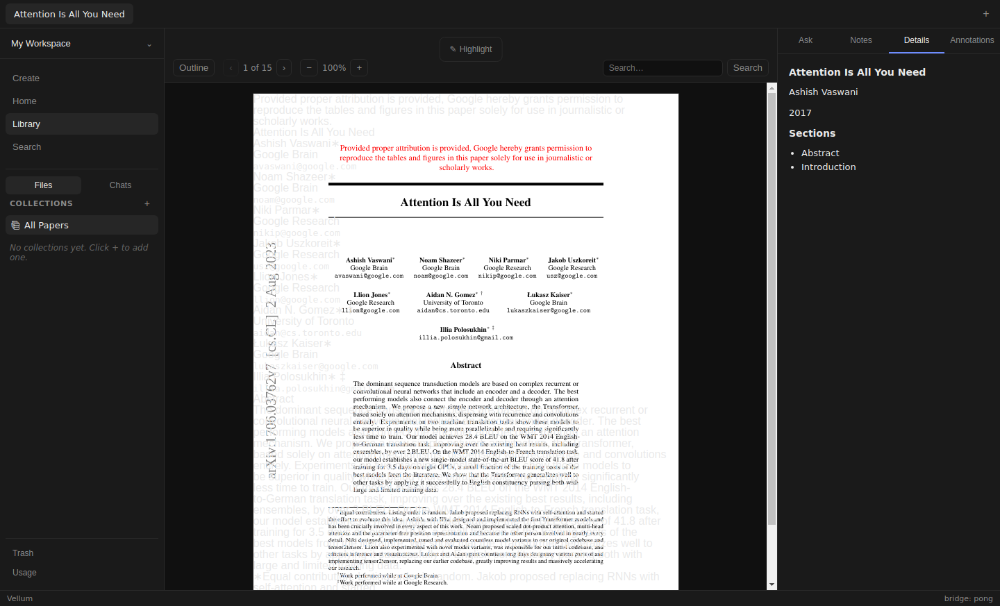

# Issue 143 verification

2026-11-05; base `757b5f886bf79db9761ed59889ad89fec4a69aab`.

## Terminal contract

`AcpSession.prompt` yields through `done`; `AcpUpdate.data` remains unknown
([client](../../../core/acp/client.ts)). Production transport exposes prompt
response `stopReason` on `done` ([transport](../../../core/acp/stdio-client.ts)).
Installed `@agentclientprotocol/sdk` 1.2.1 defines `end_turn`, `max_tokens`,
`max_turn_requests`, `refusal`, and `cancelled`
([primary protocol source](https://agentclientprotocol.com/protocol/prompt-turn#stop-reasons);
local declaration: `node_modules/@agentclientprotocol/sdk/dist/schema/types.gen.d.ts`).

- Explicit `end_turn`: completed; existing parse/shape checks still apply.
- Error update, thrown stream, EOF without done, or exposed non-`end_turn`
  reason: extraction retains parseable fields with `degraded: true`; summary absent.
- Compatibility: reasonless `done` remains completed, including `{}`, null, and
  undefined data used by legacy clients. No new protocol requirement imposed.
  Unknown explicit reasons fail conservatively; tests cover `future_reason`.
- Both functions still attempt disposal. Summary text is never used as a
  completion signal. No retry/recovery, transport deadline, or repair of previously
  stored unfinished summaries added. A stream that never terminates still depends
  on transport behavior. Events after the first terminal event are not consumed.

## Automated evidence

- Red: valid extraction JSON followed by error/throw/EOF: **3 failed**;
  nonempty summary then error/EOF: **2 failed**, throw already passed.
- Red: all four interrupted SDK reasons plus unknown explicit reason:
  **10 failed** across extraction and summary.
- Persistence negative control against original summary implementation:
  **1 failed**, reopened paper contained `"Unfinished summary."`.
- Green: focused ingest/extraction/summary **47 passed** after Node binding restored.
- `npm test`: **41 files, 406 tests passed**.
- `npm run typecheck`, `npm run build`, `git diff --check`: passed.

Logs: `/tmp/vellum143-{extract-red,summary-red,stop-red,persistence-red,focused-final,tests,typecheck,build}.log`.

## Isolated real-paper Electron exercise

Built Electron 32.3.3, Playwright under Xvfb. Disposable copy of `out/`, unique
`VELLUM_DATA_DIR`, unique Chromium profile, app-only empty adapter PATH. Production
sources and original generated bundle unchanged by injection. Temporary script:
`/tmp/vellum143-evidence/live.mjs`; result and main/renderer logs in same directory.

Verification-only override of `StdioAcpClient.prototype.newSession` in copied bundle:
extraction yields valid JSON in two chunks (title, one author, year, two sections);
summary yields nonempty `UNFINISHED ISSUE143` text in two chunks. Both turns then
emit error, throw, or end without done, respectively, for three separate imports.
Six terminal paths and six disposals logged. Values deliberately canned, not agent
analysis. No test hooks, sign-in, provider calls, or personal configuration changes.

Real PDF: Vaswani et al., *Attention Is All You Need*, arXiv:1706.03762, 15 pages;
SHA-256 `bdfaa68d8984f0dc02beaca527b76f207d99b666d31d1da728ee0728182df697`.

Clicked Library and checked empty state. For each failure, clicked Create, checked
input focus and disabled empty submit, typed local PDF path, clicked Add Paper,
observed loading and modal dismissal. Reader canvas displayed paper; Details showed
salvaged metadata and sections with no Summary heading or unfinished text.
`getPaper` confirmed absent summary; stored PDF bytes matched original and Markdown
contained paper title. Restart retained all three records unchanged; reopening
paper retained visible metadata and absent summary. Screenshot visually inspected.

Renderer errors/warnings/page errors: **none captured**. Main process logged
`Exiting GPU process due to errors during initialization` and DBus
`org.freedesktop.DBus.Error.NoReply`; PDF canvas still rendered. Native SQLite binding
backed up locally before Electron rebuild, restored byte-for-byte afterward.

Limits: deterministic injected enrichment, **not signed-in live ACP verification**;
Codex smoke deliberately separate per task. Built app tested, not dev server or
packaged distribution. Screenshots still show existing duplicated/misaligned PDF
text layer tracked in #86; no reader fix included. No whole-document fidelity claim.

## Self-review

Standards: reviewed complete diff against AGENTS/CLAUDE; no findings. Production
changes limited to two enrichment consumers; typed boundary and disposal preserved.
Spec: reviewed #143 acceptance criteria against regressions and live evidence; no
missing implementation found. Independent reviewer has not repeated live procedure.
