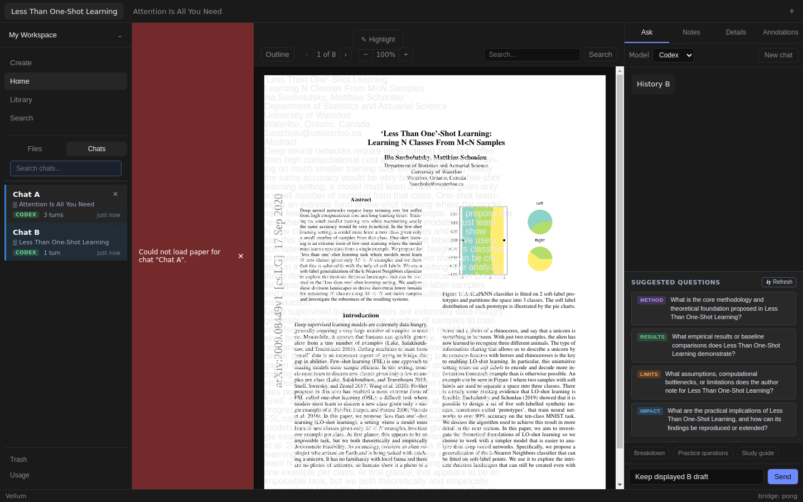
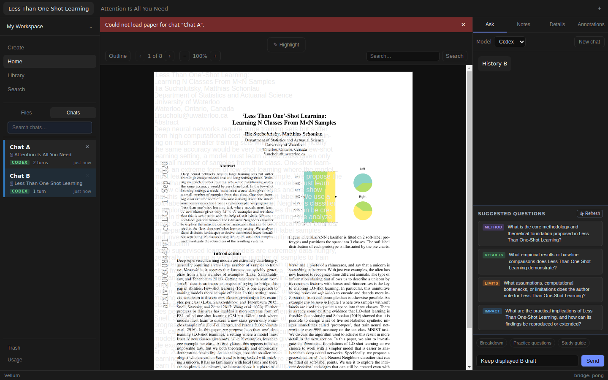
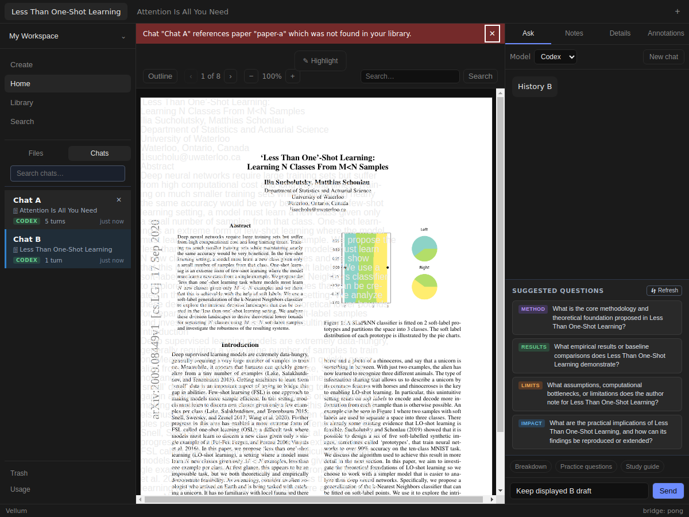

# Issue #149 verification

Base `f97313bf7e06d1d22461494b35a73bb2a40845f0`, verified 2026-11-06.
Target `fix/147-chat-navigation-ownership`. Stack #150, #146, #126, #97.

## Change and regression

App stacks chat errors above a flex content wrapper. Wrapper retains Reader's
remaining height and toolbar containing block. No navigation, Reader, backend,
IPC, or persistence logic changes. Dismissal has a descriptive name and visible
keyboard outline. Banner text wraps; dismissal cannot shrink out of view.

Reused prior delegate's uncommitted public App regression by reading and applying
its diff. Old checkout untouched. Before fix, both missing/rejected cases fail
because `Dismiss chat navigation error` is absent; 38 existing tests pass.
After fix, all 40 App tests pass. Tests Tab to dismissal, press Enter, retain B's
selection/draft and Ask session, then retry A successfully. No CSS class assertions.

- Red: `/tmp/vellum149-red.log`.
- Focused green: `/tmp/vellum149-green.log`.
- Full `npm test`: 41 files, 442 tests pass; `/tmp/vellum149-tests.log`.
- Typecheck/build/diff check pass; `/tmp/vellum149-typecheck.log`,
  `/tmp/vellum149-build.log`.

## Live Electron

Playwright Electron under Xvfb. Fresh isolated profiles and SQLite databases.
Real PDFs plus extracted markdown: Attention Is All You Need (2,215,244 bytes),
Less Than One-Shot Learning (3,542,378 bytes). Existing store functions seed paper
metadata and two chat histories; ingest is not exercised.

Temporary compiled main-bundle copy injects queued `getPaper` holds, null results,
and rejection. ACP session transport emits deterministic text. Renderer/preload,
IPC validation, SQLite, paper files, PDF.js, deletion, and Ask remain real.
No credentials or signed-in ACP subprocess. Generated main copy removed on exit.
No production instrumentation committed.

Actual clicks select B, type draft, then select A while lookup is held. Release
missing/rejected result, check B remains selected with its draft and usable Ask.
Tab to named dismiss button, inspect visible outline, press Enter. Retry A, type
and Send, verify durable A session routing. Repeat at 1440, 1200, and 1000×900.
Delete pending A, preserve B draft, Send B, restart. B history and A deletion persist.
Initial empty reader and held-lookup state checked. PDF text checked after loading.

Baseline built run: `/tmp/vellum149-live-dHmfVZ/`.
Fixed built run: `/tmp/vellum149-live-kcnqat/`.
Fixed development run: `/tmp/vellum149-live-W4hjS1/`.
Each contains screenshots, `result.json`, `geometry.json`, renderer/main logs.
Script `/tmp/vellum149-live.mjs`; output `/tmp/vellum149-live-built.log` and
`/tmp/vellum149-live-dev.log`. Development renderer started through
`npm run dev -- --rendererOnly --noSandbox` under Xvfb; `/tmp/vellum149-dev.log`.

At 1440px: banner 882×35; Reader 882×801 directly below, bottom unchanged.
At 1200px: banner 642×35; Reader 642×801. No document or center-pane overflow.
At 1000px: banner 442×40 for missing, 442×35 for rejection; Reader width/bottom
unchanged. Existing Reader toolbar overflows at 1000px even without errors (#151).
Banner fits and adds no overflow. No-error Reader rectangles exactly match base
at 1440/1000px; dismissal restores those rectangles at every width.

Screenshots visually inspected. Renderer errors/warnings/page errors: none in
baseline, built, and development runs. Main stderr contains expected injected
lookup rejection traces, headless GPU/DBus diagnostics, and debugger notices.
Preview failed twice with `net::ERR_CONNECTION_REFUSED`; no tab remained open.
Initial development launch without X display failed; Xvfb launch and rerun passed.

## Review and limits

Inline standards/spec self-review against pinned base and #149: no remaining
findings. Checked flex sizing, Reader toolbar anchor, wrapping, focus, preserved
navigation/deletion/drafts, renderer isolation, and scope. No subagents or
independent review. Repository lacks `docs/agents/issue-tracker.md`; issue read
with `gh`. Independent live review remains required before merge.

Private native SQLite binding backed up, rebuilt for Electron, then restored.
No Node tests overlapped rebuild. Restored binding opened an in-memory Node DB.
SHA-256 `45cb92a176fb758533db6d9a343acdfc73e4de27ac4c20a0cb2a6fb5be3e84f2`.

No signed-in ACP smoke or grounded-response quality claim. No macOS/Windows or
packaged-app verification. Deterministic responses prove UI recovery and routing,
not natural IPC failure frequency. Existing PDF text overlap #86 and outgoing PDF
loading #148 remain separate. Narrow Reader toolbar tracked in #151; no Reader
changes here. Draft PR only; no merge, watch, labels changed, or phase unlocked.
