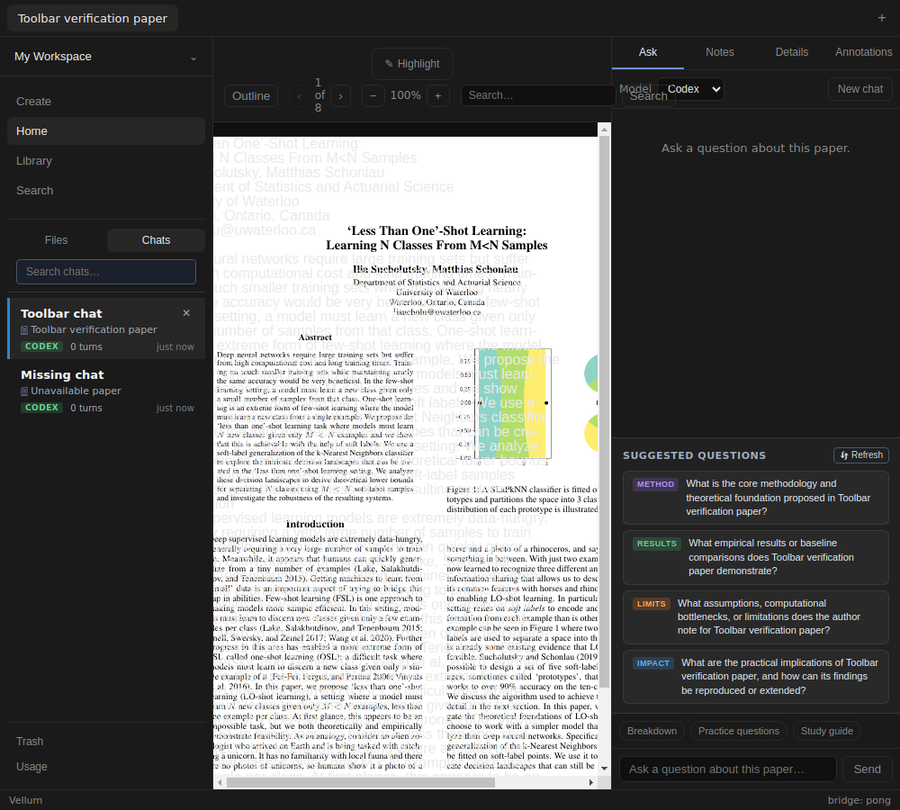
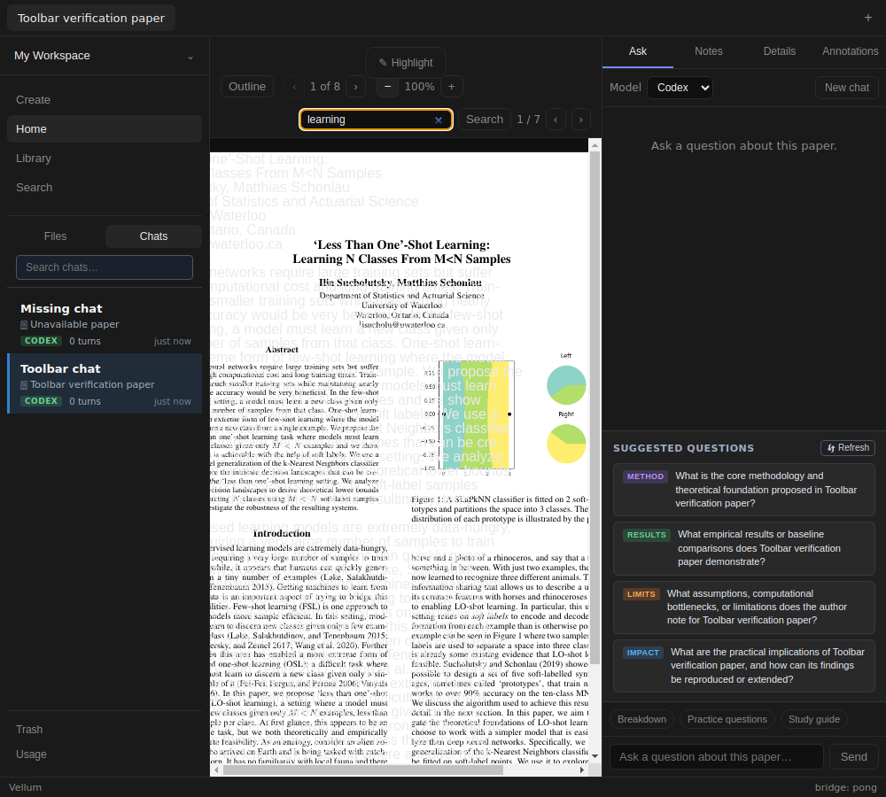
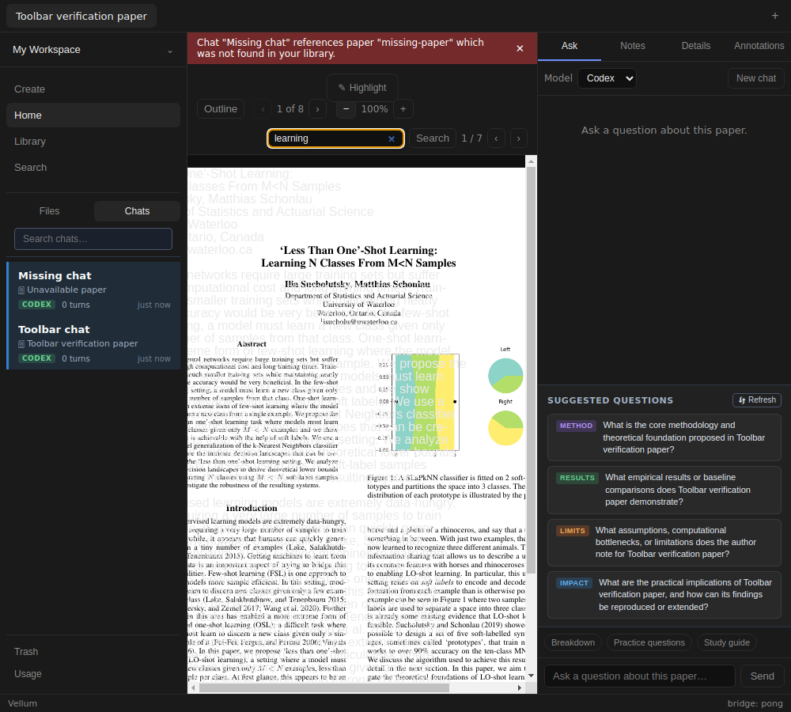
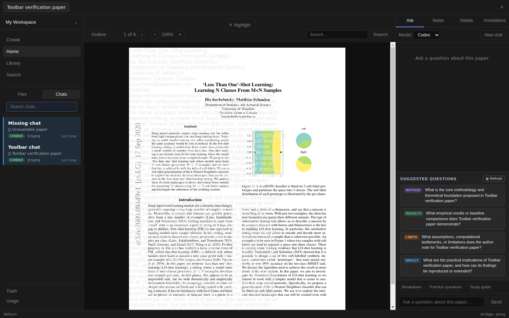

# Issue #151 verification

Verified 2026-11-06 in `/home/dandapat/.t3/worktrees/Vellum/t3-f26151f0`.
Pinned parent `0d72bd79f5eaf79adec10f28a6aea44d296c113f`.
Branch `fix/151-reader-toolbar-fit`; target `fix/149-navigation-error-banner-602cb113`.
Stack, bottom first: [#97](https://github.com/dkritarth/Vellum/pull/97),
[#126](https://github.com/dkritarth/Vellum/pull/126),
[#146](https://github.com/dkritarth/Vellum/pull/146),
[#150](https://github.com/dkritarth/Vellum/pull/150),
[#152](https://github.com/dkritarth/Vellum/pull/152), then this draft.

## Change and regression

Reader toolbar wraps groups when the center pane cannot fit them. Page and zoom
labels stay on one line; search can wrap as match controls appear. Search input
retains at least 128px. No controls hidden, overflow clipped, markup reordered,
or Reader document/rendering/selection behavior changed. Production diff is seven
CSS declarations in `Reader.module.css`.

Before CSS edits, the committed Electron gate failed at 1000×900:
`Search in document exceeds center 237..679, control 511.625..684.625`.
Center clientWidth was 442; scrollWidth was 514. Search button ended at 750.859375.
The page label also wrapped vertically. Red output `/tmp/vellum151-red.log`;
fresh baseline `/data/dandapat/.tmp/vellum151-live-v0FlJ6/`.
Parent comparison at all widths remains `/tmp/vellum152-parent-live-TOY6v1/`.






## Live Electron procedure and measurements

Focused gate reuses `test/harness.mjs`. It requires an existing multi-page real PDF,
production build, Electron-compatible SQLite binding, and display:

```bash
npm run build
READER_TOOLBAR_PDF=/path/to/paper.pdf xvfb-run -a node test/reader-toolbar-live.mjs
```

Used Less Than One-Shot Learning, 3,542,378 bytes, eight pages. Gate copies PDF and
extracted markdown into a unique isolated data directory. A temporary compiled
main entry seeds metadata/chat rows, makes one chat's paper lookup return null,
and replaces ACP session transport. Renderer, preload, PDF.js, SQLite, file reads
and Reader controls remain real. No credentials or signed-in adapter invoked.
Ingest and natural backend failure frequency are not tested.

Actual clicks open Chats and the paper. Each width tests banner absent/present,
page forward/back with changed rendered text, zoom with changed canvas dimensions,
search submission by Enter, previous/next match, and zero matches. Tab traversal
checks DOM order and visible outline for every enabled toolbar control, including
match buttons. Checks every control's rectangle, pairwise overlap, readable input,
both visible sidebars, Ask boundary, document/center overflow and remaining height.
Banner dismissal restores Reader geometry. Empty state and reopening after app
restart also pass. Search/page/zoom persistence across restart is not promised.

All viewport heights are 900px; center starts at x=237 and ends at Ask's left edge.
Measurements below are no-search-result states; full control rectangles and search
states are in [geometry.json](issue-151/geometry.json). Fresh failing rectangles
are in [before-geometry.json](issue-151/before-geometry.json).

| Width | Center x range | Toolbar height | Rightmost control | Paper area, no banner | Paper area, banner | Center scroll/client width |
| --- | --- | --- | --- | --- | --- | --- |
| 1000 | 237..679 | 115 | 667 | 721 | 681 | 442 / 442 |
| 1200 | 237..879 | 78 | 867 | 758 | 723 | 642 / 642 |
| 1440 | 237..1119 | 78 | 1107 | 758 | 723 | 882 / 882 |

Built gate `/data/dandapat/.tmp/vellum151-live-IukqnP/`, output
`/tmp/vellum151-green-final.log`. Development gate
`/data/dandapat/.tmp/vellum151-live-Vfmd5X/`, output
`/tmp/vellum151-dev-gate.log`. Each retains screenshots, geometry, renderer log
and result JSON. Renderer warnings/errors/page errors: none in both runs.
Screenshots visually inspected. Existing PDF text-layer misalignment is visible;
it is outside #151 and remains covered by separate Reader work.

Development launched with `npm run dev -- --noSandbox` under Xvfb and isolated
VELLUM_DATA_DIR; gate used `ELECTRON_RENDERER_URL=http://localhost:5173`.
Main dev stderr has headless GPU initialization and DBus diagnostics. An initial
attempt with unsupported `--rendererPort` failed before app launch; corrected
command and complete dev gate passed. Shared preview opened successfully and was
closed; verification uses the actual Electron window through Playwright.

## Automated verification and review

- `npm test`: 41 files, 442 tests pass; `/tmp/vellum151-tests.log`.
- `npm run typecheck`: pass; `/tmp/vellum151-typecheck.log`.
- `npm run build`: pass; `/tmp/vellum151-build-final.log`.
- Focused built and dev gates: pass, including rendered page/zoom and geometry.
- `git diff --check` and `node --check test/reader-toolbar-live.mjs`: pass.

Private checkout SQLite binding backed up before Electron rebuild and restored
before Node tests. No tests overlapped rebuild. Restored binding opened an
in-memory Node DB; SHA-256
`45cb92a176fb758533db6d9a343acdfc73e4de27ac4c20a0cb2a6fb5be3e84f2`.

Inline code-review skill applied against pinned parent and issue #151. Standards:
no remaining findings; existing tokens, spacing and renderer isolation preserved.
Spec: no remaining findings; controls fit, stay visible and retain behavior.
No subagents or independent review. Repository lacks `docs/agents/issue-tracker.md`;
issue read through `gh`. Independent live review remains pending.

No signed-in ACP smoke or grounded-answer claim. Linux/Xvfb only; no macOS,
Windows, packaged distribution, extreme zoom/DPI or arbitrarily narrow mobile
verification. No changes to #148 ownership, #99 cancellation, #95 alignment,
#141 assets, storage or IPC production code. Draft only; no merge, watch,
phase unlock, or issue-label changes.
