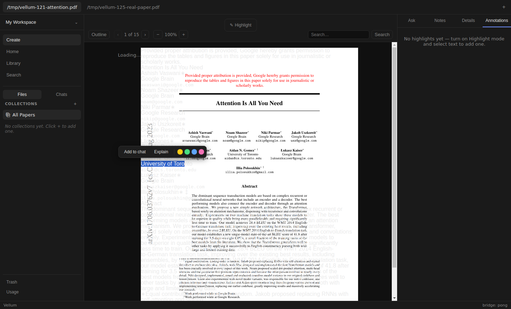
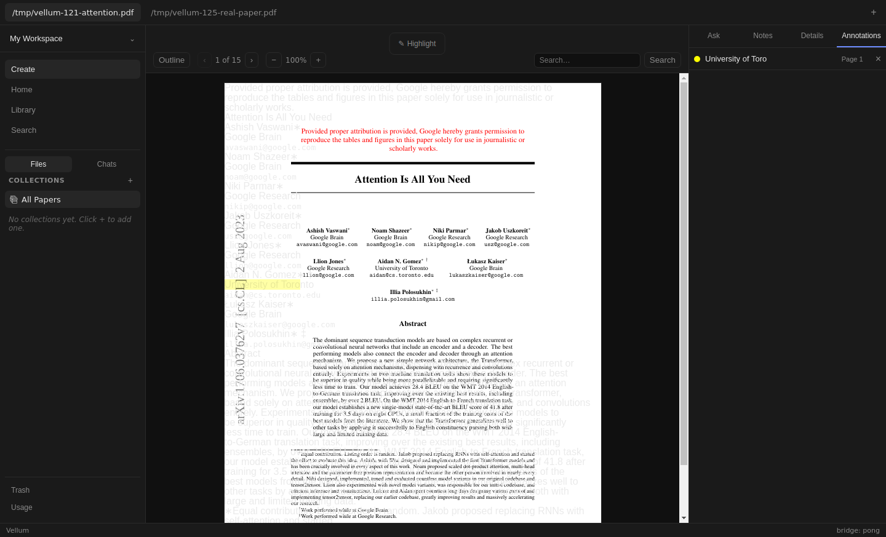
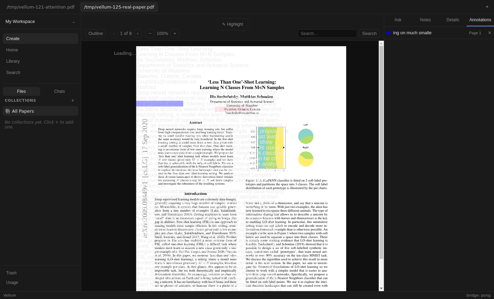
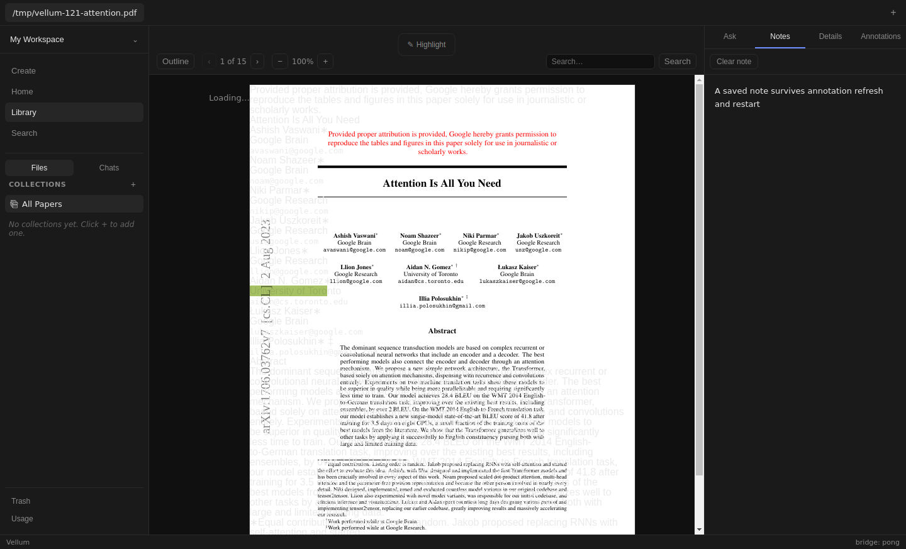

# Issue 175 verification

Base: PR [#106](https://github.com/dkritarth/Vellum/pull/106), `c579a92a914fa22f4d9563b4c85f1c333ae6b173`, branch `fix/library-panels-races`. Scope contract: [#175](https://github.com/dkritarth/Vellum/issues/175). No independent Reader/App draft commits were imported.

## Result

Reader creation now refreshes the already open Annotations list for its paper. Actual App, Reader, RightPanel and AnnotationsPanel integration reproduced the bug on the exact base before production edits. The record was saved, while the panel still said `No highlights yet`. See [checks.txt](checks.txt) for red/green output and commands. Full raw logs remain in `/tmp/vellum175-evidence/`.





## Renderer contract

`Reader.onHighlightCreated(paperSlug)` runs only after `highlightsCreate` resolves, for both highlight mode and selection-menu creation. The slug comes from the persisted record. App owns per-paper invalidation counts, not copies of durable highlight records. It passes only the active paper's count as `highlightsRevision` through RightPanel to AnnotationsPanel.

AnnotationsPanel reads storage when its slug or revision changes. A late creation for A advances only A's count, so B's open list does not refresh. Opening a closed tab reads saved data normally. Request versions extend #106's slug guard so obsolete success, rejection, and loading completion cannot overwrite newer reads for the same paper or a later visit to that paper. A refresh retains existing rows and DOM identity, preserving row focus. A paper change still clears outgoing rows.

No backend, preload, schema, global events, polling, shared annotation store, or visual layout changes. Delete-to-Reader freshness remains outside scope.

## Automated proof

- Initial App integration regression failed on the exact #106 base before production edits. It used the real four renderer modules and external PDF.js/storage doubles only.
- Final App integration has five cases: immediate correct single quote/page/color row and jump; repeated creations through menu and highlight mode; failed create without refresh/row; closed tab; late A completion while B stays open, followed by return to A.
- Four additional panel cases cover obsolete same-paper success/error/loading, return visits, and focus retention. All four fail when request ownership is reduced to the original slug-only guard. Raw negative control: `/tmp/vellum175-evidence/ordering-red.log`.
- Focused tests: 64 passed. Full `npm test`: 395 passed across 42 files. Typecheck, build, and `git diff --check` passed.
- Existing Reader tests print jsdom's missing canvas-context diagnostics. They pass; this is separate from actual Electron verification.

## Actual Electron procedure

[Live harness](live.mjs) runs the built app through Playwright Electron, production preload/IPC/SQLite and real PDF.js. [Dev smoke](dev-smoke.mjs) launches `npm run dev` and controls only its isolated Electron instance through its dedicated local CDP port. Both use isolated data/config/cache, with inert `codex-acp` and `claude-code-acp` executables first on PATH. No personal configuration, credentials, real ACP sessions, or model requests.

Inputs: locally available real PDFs, Attention Is All You Need and Less Than One-Shot Learning. Exact SHA-256 hashes and ingested paths appear in [live-result.json](live-result.json). The app's existing local ingest names these papers after their input paths. No PDF is added to git.

Run commands from repository root. Replace the PDF paths when needed. Stop Node SQLite tests before rebuilding its native binding; finish Electron before restoring it.

```bash
npm run build
cp node_modules/better-sqlite3/build/Release/better_sqlite3.node /tmp/vellum175-node-binding.node
sha256sum node_modules/better-sqlite3/build/Release/better_sqlite3.node > /tmp/vellum175-native.sha256
npx electron-rebuild --force --only better-sqlite3
xvfb-run -a node docs/verification/issue-175/live.mjs /tmp/vellum-121-attention.pdf /tmp/vellum-125-real-paper.pdf /tmp/vellum175-live-final
xvfb-run -a node docs/verification/issue-175/dev-smoke.mjs
cp /tmp/vellum175-node-binding.node node_modules/better-sqlite3/build/Release/better_sqlite3.node
sha256sum -c /tmp/vellum175-native.sha256
npm test
npm run typecheck
npm run build
git diff --check
```

Dev smoke uses `/tmp/vellum-121-attention.pdf`, port 19375, and `/tmp/vellum175-evidence/` for evidence. Ensure the input and evidence directory exist and the port is free. Both scripts preserve isolated data for inspection. Native backup for this run was `/tmp/vellum175-evidence/node-better_sqlite3.node`; its exact SHA-256 was restored before final Node checks.

Observed built flow:

1. Open empty Annotations, ingest both real PDFs using Create and typing local paths.
2. Save B's unrelated note. Make a native text selection by mouse drag, click visible blue action, and verify one B row.
3. Open A, keep Annotations open, make native selection, click visible yellow action. Verify exact quote, Page 1, yellow swatch, one row, and Annotations still selected.
4. Navigate Reader to page 2 and click the annotation. Reader returns to page 1. Row keeps focus; Tab reaches its labeled Delete button.
5. Save A note; create green highlight while Notes is open. Open Annotations and verify both rows.
6. Inject one controlled create rejection. Neither saved records nor row count changes.
7. Hold A creation before persistence, switch visibly to B, then release. B retains its exact original record. Return to A; all three saved rows load.
8. Restart actual Electron process using the same isolated data. Verify A/B records exactly, both notes, and unchanged ingested PDF/Markdown hashes.

Dev flow independently verifies native selection and yellow creation while Annotations remains open. See [checks.txt](checks.txt) for its result.

## Injections and limits

Only built flow steps 6 and 7 wrap Electron 32's private `ipcMain._invokeHandlers` entry for `vellum:highlights-create`. Ordinary calls still invoke the original production handler. One rejection bypasses persistence deliberately. One delayed call invokes original validation/persistence on release. Renderer, preload, PDF bytes/layout, native Selection, and React callbacks are never replaced. Private IPC map is verification-only and version-specific. Unit integration doubles PDF.js and storage; it is not native rendering proof.

Initial live attempt selected top-of-page text, placing the existing selection menu behind Reader toolbar. A second attempt selected before the destination text finished changing. Final harness selects lower visible text and waits for destination text after paper switch. These are harness accommodations for base Reader behavior, not product fixes. Logs/screenshots remain at `/tmp/vellum175-live/`, `/tmp/vellum175-live-r2/`, and `/tmp/vellum175-live-r3/`.

Base #106 visibly misaligns PDF text/overlays, includes zero-width overlay fragments, and lacks independent Reader stack race fixes. Native colored geometry was visible, but accurate PDF fidelity and late Reader-overlay ownership are not claimed. Selection retirement and repeated jump behavior from independent #174 are not included. This PR verifies list ownership, not those Reader behaviors. UI and accessibility checks cover affected controls and focus only, not a full accessibility audit. ACP support remains unverified.

Renderer console captured no warnings, errors or page errors in final built/restart/dev runs. Main-process logs contain sandbox D-Bus errors, deliberate injected create rejection, debugger shutdown messages, and dev GPU initialization error. See [main-stderr.txt](main-stderr.txt), [restart-stderr.txt](restart-stderr.txt), and [dev-main.txt](dev-main.txt). Do not interpret this as a warning-free main process.





## Self-review

Reviewed against #106 base, AGENTS/CLAUDE and issue #175 on Standards and Spec axes, locally, honoring no-subagent instruction. Fixed callback indentation. No remaining scope, renderer-isolation, or list-ownership findings. All production edits stay in the four authorized renderer files. Independent review and its repeated live run remain pending. Draft only; no merge, watch, or dependency unlock.
