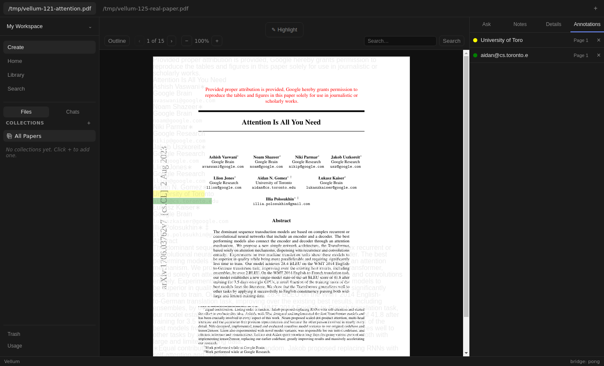
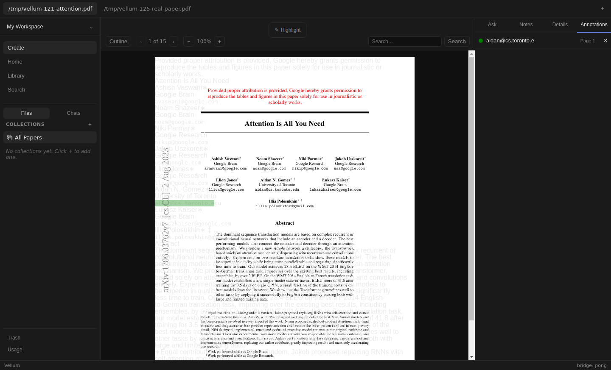
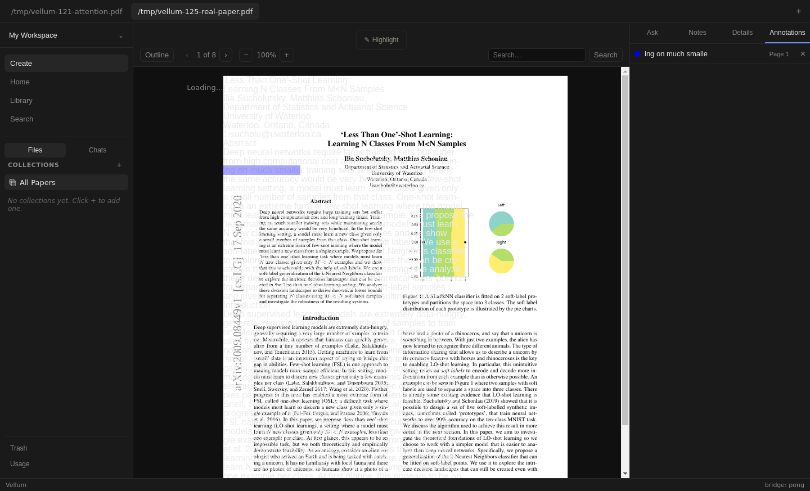
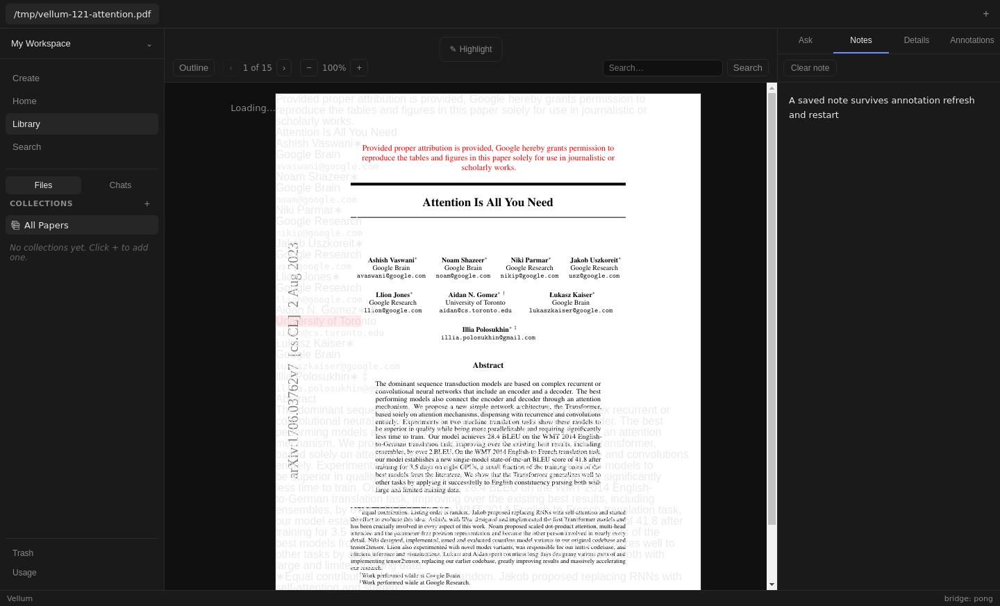

# Issue 177 verification

Contract: [#177](https://github.com/dkritarth/Vellum/issues/177). Exact base: [#176](https://github.com/dkritarth/Vellum/pull/176), `42b0d14ba2252c7096c41545fbcfcaf754f8ff14`, above [#106](https://github.com/dkritarth/Vellum/pull/106). Independent Reader #174 changes neither imported nor duplicated.

Successful visible annotation deletion now removes corresponding Reader overlay without navigation. Failed deletion retains record, row, and overlay. Base reproduced through actual App, Reader, RightPanel, and AnnotationsPanel before production edits. Storage/list emptied; one overlay remained. [Base red](red.txt): one failed success-delete case, one passing failure control. Initial local attempt lacked dependencies and never executed tests; recorded red follows `npm ci` on exact base.




## Renderer contract

Paper revision means per-paper invalidation count, not durable highlight records. Existing App revision state now advances after successful deletion as well as creation. AnnotationsPanel reports captured originating slug only after `highlightsDelete` resolves. RightPanel forwards callback. Failed delete publishes nothing. Panel keeps existing standalone refresh; App revision also refreshes its mounted list. Overlapping reads retain existing panel request guards.

Reader receives active paper revision. Highlight refresh lives separately from PDF loading, so revision changes neither reload document nor reset page. Request versions and current slug guard both resolved records and rejected reads. Effect cleanup retires reads across revisions, paper switches, return visits, and unmount. Successful local creations retire outstanding reads before appending; outgoing creations cannot append to current paper. App reconciles current creations through same revision refresh. No backend, preload, schema, event bus, polling, shared store, or layout changes.

## Automated evidence

[Checks](checks.txt) records focused/full results. New integration suite exercises visible overlays/list through real renderer modules. Only external PDF.js, preload storage, and selection rectangles are doubled. Tests cover successful deletion, failure without refresh, remaining green highlight, late deletion through reused open-paper tabs, obsolete Reader success/error, overlapping mutation reads, earlier visits, and outgoing creation. Existing #176 suite retains both creation paths and closed/open list behavior. Component tests prove success callback timing, originating slug, and no callback on failure.

[Negative guard control](guard-negative.txt) replaces Reader request-version check with slug equality alone. Three tests fail: obsolete Reader success, obsolete Reader rejection, and obsolete post-delete snapshot. Other six cases pass. Final suite additionally tightens tab reuse and tests outgoing creation. Full request guard restored before final checks. No native SQLite tests overlap Electron rebuild.

## Live procedure

[Built harness](live.mjs) uses actual Electron, production preload/IPC/SQLite, PDF.js, native mouse selection, and visible buttons. [Dev smoke](dev-smoke.mjs) runs `npm run dev`, connects only its dedicated CDP port 19377, and repeats native create/delete with empty storage/list/overlays. Both isolate app data/config/cache/profile and prepend inert ACP executables. No credentials, personal configuration, or model calls. Preview tool rejected Electron `file:` URL with `unsupported-protocol: file:`; Playwright Electron controls actual app instead.

Inputs: Attention Is All You Need and Less Than One-Shot Learning, ingested through Create with typed local paths. [Results and SHA-256 hashes](live-result.json) identify input and ingested PDF/Markdown files. PDFs remain outside git.

1. Open empty Annotations; ingest both real papers visibly.
2. Save B note; select text by native mouse drag and click blue highlight action.
3. Switch A through open-paper tab. With Annotations open, select text and click yellow action. Verify exact quote/page/color row. Jump from page 2 via annotation, retain row focus, Tab to labeled Delete.
4. Save A note. Create green while Notes open; reopen Annotations. Distinct passages show both rows and colored overlays.
5. Click first visible Delete. Yellow overlay disappears; green overlay and row remain. No navigation/remount.
6. Inject one controlled delete rejection. Click remaining Delete. Exact stored record, row, and green overlay remain.
7. Focus annotation row; Tab to Delete; Enter starts held A deletion. Switch visibly to B. Release A deletion. B blue overlay, row, and exact stored record remain unchanged. Return A: storage/list/overlays empty.
8. Native pink creation updates A list/Reader after multiple deletes. Restart Electron process with same isolated state. Exact A/B highlights, pink/blue visible overlays, both notes, input PDFs, and ingested PDF/Markdown hashes remain.

Built and restart renderer consoles captured zero warnings/errors/page exceptions. Dev renderer emitted Vite debug and React DevTools info only; no warnings/errors/page exceptions. Main logs retain host D-Bus errors, intentional injected delete rejection, debugger shutdown, and dev GPU initialization error. See [built main](main-stderr.txt), [restart main](restart-stderr.txt), [dev main](dev-main.txt), and [dev renderer](dev-console.txt). Full local artifacts: `/tmp/vellum177-live-distinct/`, `/tmp/vellum177-evidence/`, `/tmp/vellum177-dev.log`. Isolated built data path appears in results.







## Reproduce

From checkout root, with dependencies installed and two local real PDFs available. Finish Node checks before native rebuild. Run Electron flows sequentially; stop Electron before restoring binding.

```bash
npm test
npm run typecheck
npm run build
mkdir -p /tmp/vellum177-evidence
cp node_modules/better-sqlite3/build/Release/better_sqlite3.node /tmp/vellum177-evidence/node-sqlite.node
sha256sum node_modules/better-sqlite3/build/Release/better_sqlite3.node > /tmp/vellum177-evidence/native.sha256
npx electron-rebuild --force --only better-sqlite3
xvfb-run -a node docs/verification/issue-177/live.mjs /tmp/vellum-121-attention.pdf /tmp/vellum-125-real-paper.pdf /tmp/vellum177-live-distinct
xvfb-run -a node docs/verification/issue-177/dev-smoke.mjs
cp /tmp/vellum177-evidence/node-sqlite.node node_modules/better-sqlite3/build/Release/better_sqlite3.node
sha256sum -c /tmp/vellum177-evidence/native.sha256
npm test
npm run typecheck
npm run build
git diff --check
```

Dev harness expects `/tmp/vellum-121-attention.pdf` and existing `/tmp/vellum177-evidence/`. Replace PDF path inside harness if needed. Actual run restored exact Node binary hash and passed independent in-memory SQLite query before final Node checks. Artifacts total roughly 2 MB in git; full screenshots and data remain local.

## Injections and limits

Failure/delay wrapper replaces only Electron 32 private `ipcMain._invokeHandlers` entry for `vellum:highlights-delete`. One failure rejects before persistence. One held call invokes original production validation/storage on release. Ordinary deletes use original handler. Native selection, renderer, preload, PDF layout, and storage remain real. Injection is verification-only and Electron-version-specific. Natural storage failure and live obsolete-list timing were not induced; controlled failure/delay and automated read-order tests provide that evidence.

Base Reader visibly misaligns text/overlays and emits zero-width overlay fragments. Harness selects lower visible text and waits for destination text after switches. Screenshots show these existing defects. Overlay removal/color ownership is verified; accurate PDF geometry, selection retirement, repeated jump improvements, other independent Reader race fixes, full accessibility audit, and signed-in ACP remain outside this proof. Focus checks cover row retention, Tab to Delete, accessible control labels, and Enter activation. Independent live review remains pending.

## Self-review

Standards: no remaining findings after correcting comment placement, formatting test controls, and tightening race tests to use open-paper tabs instead of Library remounts. Renderer stays isolated; production edits remain in four authorized files. Spec: all implementation and requested local verification covered; limitations above retained. Review performed locally on both axes, honoring no-subagent instruction. Draft only. No merge, watch, labels, or dependency unlock.
