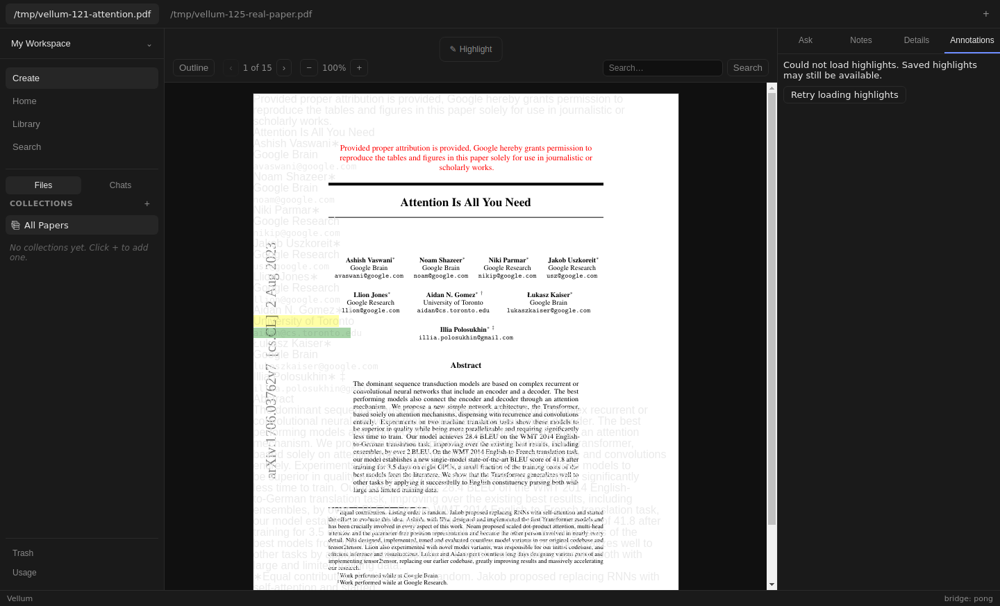
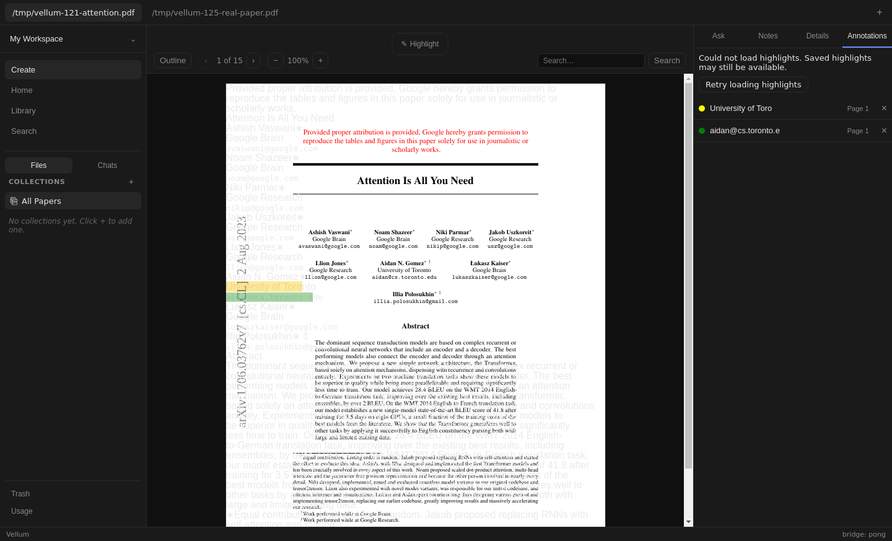
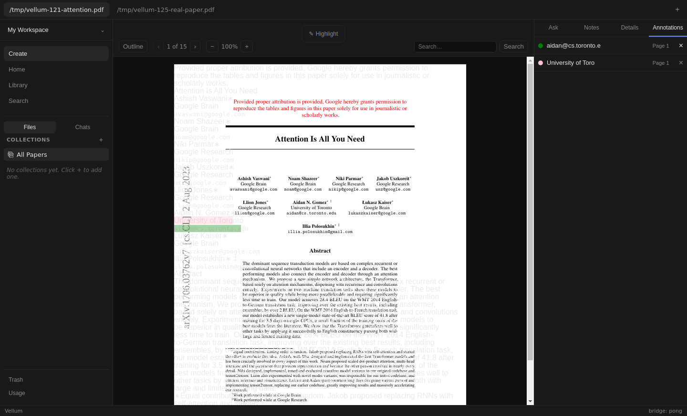
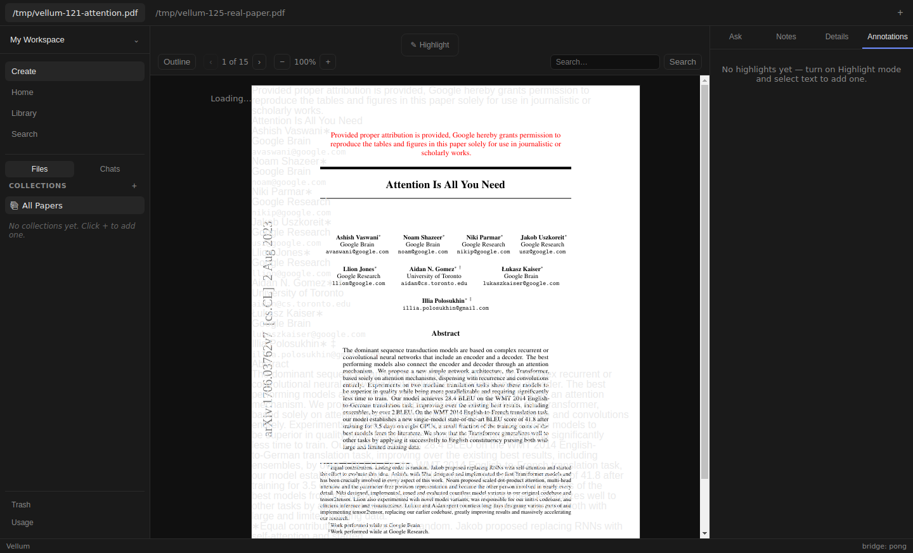
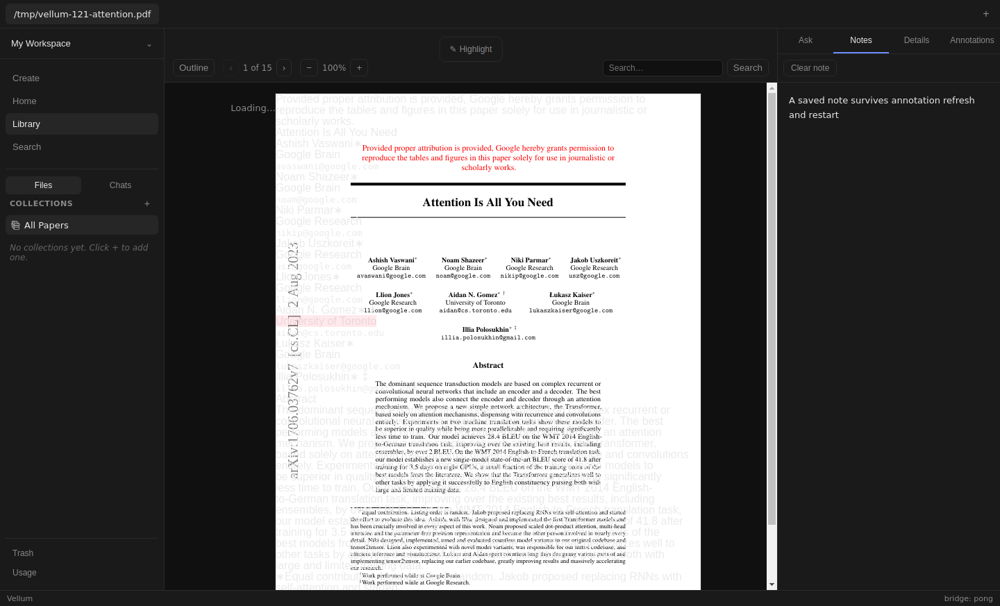

# Issue 179 verification

Contract: [#179](https://github.com/dkritarth/Vellum/issues/179). Base [#178](https://github.com/dkritarth/Vellum/pull/178), `afae3aa14416e5cc2a31672108ee56771d631a09`, above [#176](https://github.com/dkritarth/Vellum/pull/176) and [#106](https://github.com/dkritarth/Vellum/pull/106). Branch `fix/annotation-error-retry` targets `fix/annotation-delete-overlays`. No parent edits.

Failed annotation reads now show an accessible load error instead of claiming no saved highlights. Failed deletes show an error beside the retained row, with a retry bound to that row's ID. Loading, successful empty, and failed load are distinct. Known rows remain mounted and usable during failed refresh. Successful persisted deletion removes its row immediately, even if the following read fails. Existing deletion callback still updates Reader.




## State and ownership

Existing public seam remains AnnotationsPanel props and allowlisted `window.vellum` methods. No new public interface. Load errors belong to the latest list request, using existing request version and paper guards. Delete errors belong to a highlight ID within one paper visit. A visit ends on paper switch or unmount; revisiting the same slug does not revive an old failure. Pending IDs prevent duplicate deletion while awaiting persistence. Each successful operation clears only its relevant error. Rejected delete publishes no success notification. Late persisted success still reports its originating paper through #178, while obsolete local view work is retired.

## Automated proof

- [Prior public repro](prior-repro.log): two failures on parent checkout, false-empty read and silent delete failure.
- [Red](red.log): three new regressions fail on this checkout before production edits; 14 existing tests pass.
- [Green](green.log): focused panel and App integration tests, including #176 creation and #178 deletion overlays.
- [Full suite](full-test.log): 43 files, 416 tests pass.
- [Typecheck](typecheck.log), [build](build.log), and `git diff --check` pass.
- [Native restore](native-restore.log): exact original Node SQLite binding hash restored; independent in-memory query succeeds.

Additional tests cover repeated failure/recovery, refresh retaining row identity/focus/jump, late load/delete failure after switch and revisit, delayed retry superseded by deletion, correct retry ID, unrelated error retention, no false deletion callback, disabled pending retry, and failed refresh after persisted deletion. App integration checks retained storage/list/Reader overlays through failure and explicit retry. Two existing integration cases selected row index 1 after deletion; updated to remaining row index 0 because persisted deletes now remove their row before refresh finishes. Their stale-response assertions remain intact.

Full test stderr includes existing jsdom canvas `getContext` notices and deliberate error-path output. These are distinct from live renderer console results.

## Live Electron proof

[Harness](live.mjs), [results/hashes/geometry](live-result.json), [run](live.log). Production Electron, preload, IPC validation, SQLite, PDF.js, native mouse selection and visible controls remain real. Inputs are Attention Is All You Need and Less Than One-Shot Learning, ingested by typing local PDF paths through Create. No personal config, credentials, or model calls. Each process uses isolated data/config/cache/profile and inert ACP executables.

1. Open Annotations with no paper. Ingest both real PDFs. Save B note, select native text and create blue highlight.
2. Switch A through open-paper tab. Create yellow highlight with Annotations open. Verify quote/page/color. Jump from page 2; row focus remains; Tab reaches labeled Delete.
3. Save A note. Create green highlight while Notes open, then reopen Annotations. Both rows and overlays persist.
4. Reopen Annotations with held read rejection. Observe loading, then accessible load error without false empty. Repeat failed read with keyboard Retry; refocus enabled Retry and press Enter to recover exact saved records.
5. Create pink highlight with panel refresh held, while Reader's first refresh uses production handler. Focus existing row, release failure. Same row node retains focus; known rows remain, Reader shows all three persisted colors. Explicit keyboard retry recovers third row.
6. Reject yellow deletion, then reject held retry. Storage, all three rows and colored overlays remain exact. Tab from Delete reaches labeled retry; Enter retries same ID. Pending retry is disabled. Successful retry removes only yellow row/overlay and clears delete error. Main wrapper call log asserts three identical delete IDs.
7. Hold outgoing A delete rejection, switch B, release. B row/blue overlay and records remain unchanged. Revisit A without stale error. Delete remaining A rows, observe genuine empty and zero overlays. Create fresh pink highlight.
8. Restart Electron process using same isolated data. Exact A/B highlights, pink/blue overlays, both notes, source PDFs and ingested PDF/Markdown SHA-256 hashes survive.









[Dev harness](dev-smoke.mjs) also launches `npm run dev` under Xvfb, using dedicated CDP port 19379. Native selection, visible highlight creation and visible deletion update list/storage/Reader without navigation. [Dev result](dev.log). All Electron processes stop before native binding restoration and final Node checks.

Built and restarted renderer [console](console.log) has zero warnings/errors/page exceptions. [Dev console](dev-console.log) contains Vite debug and React DevTools info only. Main logs retain host D-Bus errors, intentional injected IPC rejections and debugger shutdown: [built](main-stderr.log), [restart](restart-stderr.log). [Dev main](dev-main.log) also reports GPU initialization failure under Xvfb. These are disclosed, not treated as a clean main-process log.

## Exact injections and limits

Verification-only Electron 32 wrappers replace `ipcMain._invokeHandlers` entries for `vellum:highlights-list` and `vellum:highlights-delete`. Ordinary calls invoke original production handlers. Immediate failures throw before storage. Held failures reject only when harness releases them. Panel refresh case skips one list invocation, allowing Reader refresh before rejecting panel's next read. Initial/read retry cases happen with only panel mounting. Renderer bridge, DOM, selection, callbacks and storage are not replaced.

Natural storage faults were not induced. Controlled failures/delays prove UI recovery; unit tests cover additional ordering cases. Base Reader text-layer/overlay misalignment and zero-width fragments remain visible and unchanged. Geometry accuracy, independent Reader fixes, full screen-reader audit and signed-in ACP are unverified/out of scope. No ACP smoke or model call was made. Independent review remains pending; draft only, no merge/watch/unlock.

Preview automation rejected Electron file URL with `unsupported-protocol: file:`; Node Playwright Electron controlled actual app instead. An initial harness attempt pressed Enter again after disabling Retry had retired focus; final harness explicitly refocuses enabled Retry, then passes. This was a verification sequencing correction.

Full artifacts remain `/tmp/vellum179-live-final/`, `/tmp/vellum179-evidence/`, `/tmp/vellum179-native/`; isolated data root is recorded in results. Only six screenshots and concise logs are committed.

## Reproduce

Finish Node checks before switching native ABI. Use a checkout-local copy of better-sqlite3 if other checkouts share node_modules. Back up binding, rebuild, run Electron flows sequentially, restore exact backup, then rerun Node checks.

```bash
npm test
npm run typecheck
npm run build
mkdir -p /tmp/vellum179-native /tmp/vellum179-evidence
cp node_modules/better-sqlite3/build/Release/better_sqlite3.node /tmp/vellum179-native/node-sqlite.node
sha256sum node_modules/better-sqlite3/build/Release/better_sqlite3.node > /tmp/vellum179-native/native.sha256
npx electron-rebuild --force --only better-sqlite3
xvfb-run -a node docs/verification/issue-179/live.mjs /tmp/vellum-121-attention.pdf /tmp/vellum-125-real-paper.pdf /tmp/vellum179-live-final
xvfb-run -a node docs/verification/issue-179/dev-smoke.mjs
cp /tmp/vellum179-native/node-sqlite.node node_modules/better-sqlite3/build/Release/better_sqlite3.node
sha256sum -c /tmp/vellum179-native/native.sha256
npm test
npm run typecheck
npm run build
git diff --check
```

Dev script expects Attention PDF at path above. Replace local paths if needed. Actual run copied SQLite package into this checkout before rebuilding, so shared dependency files remained unchanged.

## Self-review

Standards: renderer imports no Node/Electron, no new IPC or storage interface, strict TypeScript, local tests, narrow CSS using existing tokens and neighboring button styling. Removed list's fixed full height so errors/loading do not force redundant panel scrolling. No backend/preload/schema/framework changes. No remaining findings.

Spec: reviewed against full #179 contract and exact #178 base. Coverage includes repeated failures, correct ID, focus/row identity, latest-read ownership, paper revisits, persisted-only notifications, #176 creation and #178 overlay deletion, and isolated restart preservation. No remaining implementation findings. Natural faults, base Reader defects, ACP and independent review limits remain explicit. Both review axes performed locally, per no-subagent instruction.
