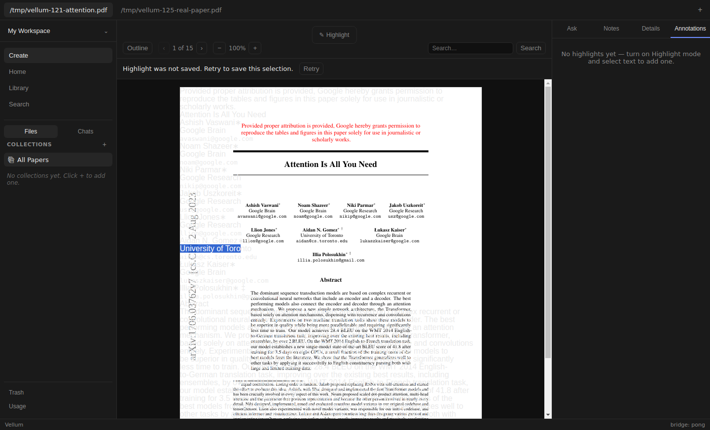
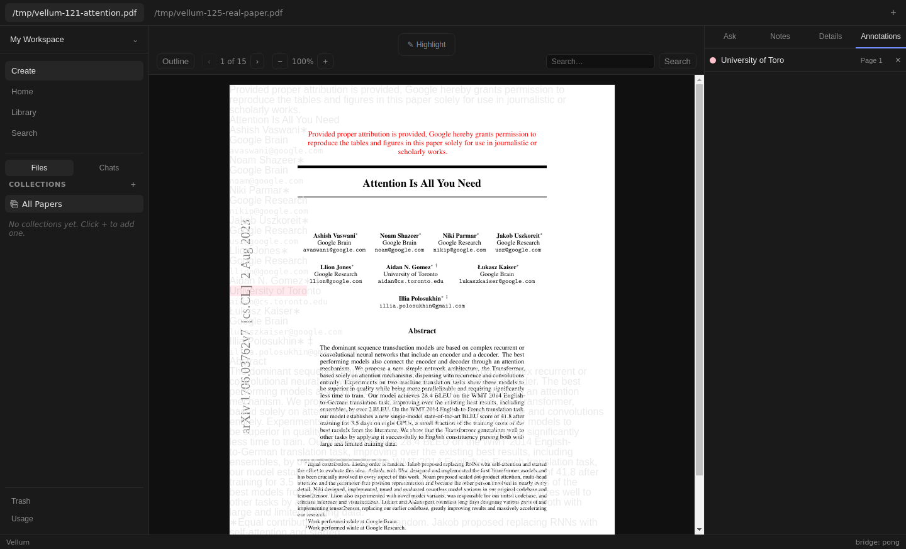
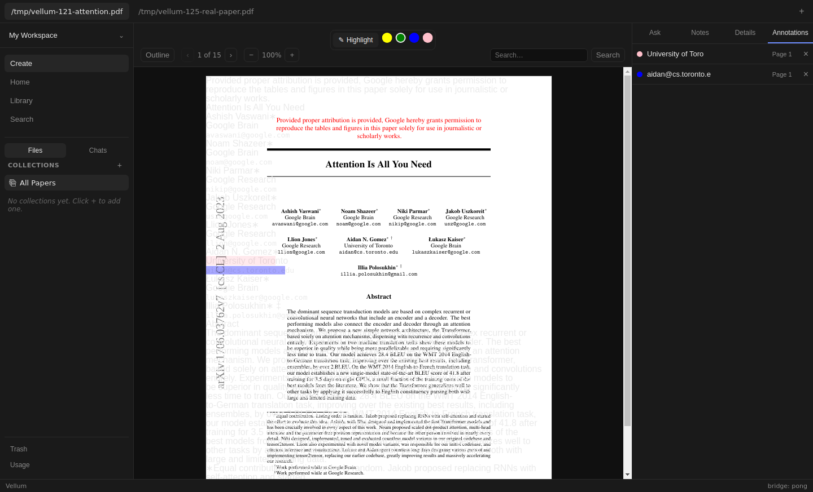
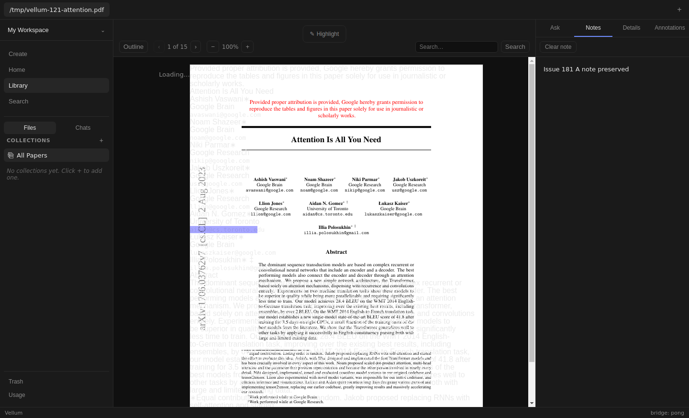
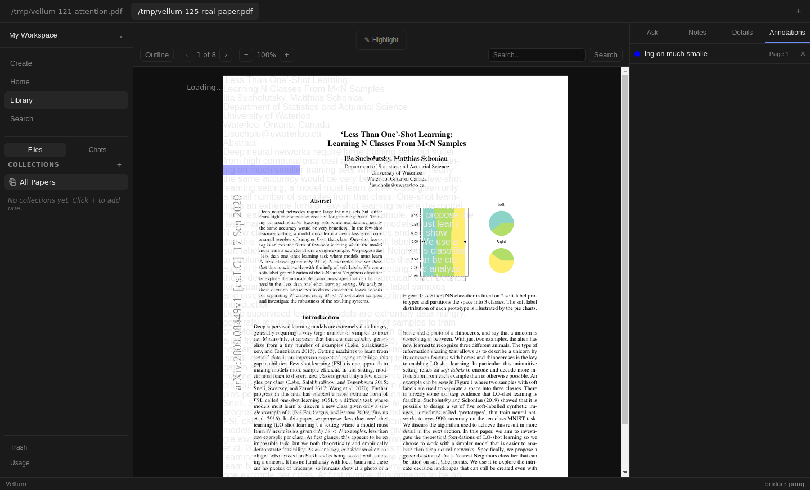

# Issue 181 verification

Both Reader highlight paths now show an accessible failed-save message and explicit Retry. Retry uses the original paper, page, quote, anchor and color without requiring native selection to survive. Failed persistence adds no overlay, list row or success notification.

Contract: [#181](https://github.com/dkritarth/Vellum/issues/181). Exact base: `0358126a1cad2ab8b5f972ce1337eed8d0179ce1`, [#180](https://github.com/dkritarth/Vellum/pull/180), branch `fix/annotation-error-retry`, above [#178](https://github.com/dkritarth/Vellum/pull/178), [#176](https://github.com/dkritarth/Vellum/pull/176) and [#106](https://github.com/dkritarth/Vellum/pull/106). This branch targets #180. No parent edits or independent #174 Reader changes.




## State and public seams

Reader owns one current save intent: captured input plus pending or failed status. Object identity retires late view updates after a different selection, navigation, paper visit or unmount. Collapsing native selection does not discard captured input, so keyboard Retry works. A noncollapsed native selection change retires obsolete intent before mouseup. Color changes do not rewrite a failed operation.

A local set tracks pending paper/page/quote/anchor combinations independently of current intent. A native drag can retire current intent through intermediate ranges, then finish over the original range. The pending set prevents that sequence from submitting the same selection twice. The set releases each entry after persistence settles. No automatic retry occurs.

Both creation paths share the same local save function. Only persisted success updates local records and publishes the existing originating-paper callback. Outgoing success can notify its paper without clearing another selection. The preload contract, backend, database and App state remain unchanged. Tests exercise the existing public App/Reader UI and preload seam, as requested. No new public seam or framework.

## Automated evidence

- [Initial red](red.txt): both original actual-App regressions fail before production changes. Original parent proof remains `/tmp/vellum-highlight-create-errors-repro/repro.test.tsx` and `result.log`.
- [Selection red](red-selection.txt): failed intent initially survived a native selection change without mouseup.
- [Jump red](red-jump.txt): same-page annotation jump initially retained obsolete error.
- [Drag red](red-drag.txt): intermediate native ranges initially allowed two submissions of one pending selection.
- [Focused green](focused.txt): 89 tests cover Reader, new retry integration, existing #176 creation, #178 deletion and #180 errors.
- [Full suite](full-test.txt): 44 files, 428 tests pass.
- [Typecheck](typecheck.txt), [build](build.txt), and `git diff --check` pass.
- [Native restore](native-restore.txt): exact Node SQLite binding SHA-256 restored; independent in-memory query succeeds. Shared parent binding hash remains unchanged.

Twelve new App integration tests cover both creation modes, repeated failure, missing native selection during retry, original color after tool changes, exact captured values, disabled pending retries, one success notification, one stored record/list row/overlay, navigation, same-page jump, native selection retirement, late failure and outgoing success preserving a new selection. PDF.js and preload storage are the only doubles. Existing unrelated jsdom canvas notices remain in test stderr.

## Actual Electron procedure and results

[Built harness](live.mjs), [result](live-result.json), [run log](live.txt). The final run uses fresh isolated data/config/cache and inert ACP executables. It ingests Attention Is All You Need and Less Than One-Shot Learning through visible controls. No personal configuration, credentials or model calls.

1. Save B's note and blue highlight, then A's note. Open A's empty Annotations panel.
2. Native mouse drag selects A text. Click visible pink action. Hold then reject creation. Confirm saving status, disabled Retry, zero stored rows and zero overlays. Failed-save alert appears.
3. From Reader search input, press Tab twice to reach Retry, then Enter. Reject again. Retry with held success. Repeated Enter while pending produces no extra invocation. Exactly one pink record appears. All three calls have identical slug, page, quote, anchor and color.
4. Enable Highlight mode and choose blue. Native drag triggers delayed rejection. Change current tool to green. Tab/Enter retries fail once, then save the original blue input. Existing pink record remains and exactly one blue record appears.
5. Different native selection retires failed Retry. Page navigation retires a held operation before rejection. Same-page annotation jump clears error and retains row focus.
6. Hold another creation, switch to B, revisit A, then reject. Neither paper receives stale error or retry. Exact stored records remain unchanged.
7. Delete A's pink highlight through its visible control. Only that row and its overlays disappear. Restart the entire Electron process with the same isolated data. Exact A/B highlights, both notes, source PDF hashes and ingested PDF/Markdown hashes survive. No retry is restored.









[Development harness](dev-smoke.mjs) launches `npm run dev` under Xvfb with dedicated CDP port 19381. Native selection and visible yellow action create a row. Visible deletion removes storage, list and Reader overlay. [Dev result](dev.txt).

Built and restarted renderer [console](console.txt) has zero warnings, errors or page exceptions. [Dev console](dev-console.txt) contains only Vite debug and React DevTools info. Main logs contain intentional rejected IPC calls, host D-Bus failures and debugger shutdown: [built](main-stderr.txt), [restart](restart-stderr.txt). [Dev main](dev-main.txt) also reports Xvfb GPU initialization failure.

## Injection contract and limits

The test-only wrapper reads `ipcMain._invokeHandlers` for `vellum:highlights-create`, removes the handler, then registers a wrapper. Ordinary calls invoke the original validated production handler. `fail` throws before storage. `hold-fail` rejects only when released. `hold-success` calls the original handler only when released. Calls record exact input. Renderer bridge, React callbacks, selection and storage are not replaced. Native drag geometry is read with DOM Range, but selection itself comes from Chromium mouse events.

Primary source: [Electron 32.3.3 ipc-main-impl.ts](https://github.com/electron/electron/blob/v32.3.3/lib/browser/ipc-main-impl.ts) confirms the map and `handle`/`removeHandler` behavior. The private map is a verification dependency, not a supported product API. Research was performed inline under the no-subagent instruction.

Natural disk or SQLite faults were not induced. Base Reader text-layer/overlay misalignment, zero-width fragments and selection geometry remain unchanged. `live-result.json` records actual overlay geometry, including a nonzero blue fragment. Exact captured text persistence is verified; glyph alignment is not. An early harness attempted to drag the same already-selected span immediately after a same-page jump: no mouseup reached its document listener and no menu opened. The final procedure selects another visible span for the switch case and passes. Broader native selection behavior and independent #174 fixes remain outside scope.

Preview rejected the Electron file URL with `unsupported-protocol: file:`. Playwright Electron controlled the actual application instead. Full screen-reader audit and signed-in ACP are unverified. No ACP smoke or model call. Independent review pending. Draft only: no merge, watch or phase unlock.

Full local artifacts: `/tmp/vellum181-live-keyboard/`, `/tmp/vellum181-evidence/`, `/tmp/vellum181-native/`. Failed harness traces remain `/tmp/vellum181-live-r2/` and `/tmp/vellum181-live-r3.log`. Final isolated data root appears in `live-result.json`. Only six screenshots and focused logs are committed. Text logs strip terminal color escapes and trailing whitespace; the initial red excerpt omits repeated accessible-role trees. Full originals remain in `/tmp`.

## Reproduce

Run Node checks before changing native ABI. Use a checkout-local SQLite package. Do not rebuild a shared package or run Node checks during Electron verification. Stop Electron, restore the exact binding, then run final Node checks.

```bash
npm test
npm run typecheck
npm run build
mkdir -p /tmp/vellum181-native /tmp/vellum181-evidence
cp node_modules/better-sqlite3/build/Release/better_sqlite3.node /tmp/vellum181-native/node-sqlite.node
sha256sum node_modules/better-sqlite3/build/Release/better_sqlite3.node > /tmp/vellum181-native/native.sha256
npx electron-rebuild --force --only better-sqlite3
xvfb-run -a node docs/verification/issue-181/live.mjs /tmp/vellum-121-attention.pdf /tmp/vellum-125-real-paper.pdf /tmp/vellum181-live-keyboard
xvfb-run -a node docs/verification/issue-181/dev-smoke.mjs
cp /tmp/vellum181-native/node-sqlite.node node_modules/better-sqlite3/build/Release/better_sqlite3.node
sha256sum -c /tmp/vellum181-native/native.sha256
npm test
npm run typecheck
npm run build
git diff --check
```

Replace PDF paths with local copies. The dev script expects the Attention PDF path shown above. Actual run copied the SQLite package into this checkout before rebuild. Other dependencies stayed shared and were not rebuilt.

## Self-review

Standards: strict TypeScript, renderer isolation, existing preload contract, local Reader state, narrow existing-token CSS and public UI regression tests. No backend, schema, parent edits or new framework. No remaining findings.

Spec: checked every #181 acceptance criterion against the base and final diff. Both modes, captured input, repeated failures, duplicate prevention, stale intent retirement, preserved notification/list/delete integration and actual isolated restart are covered. No remaining implementation findings. Natural faults, native geometry, full screen-reader audit, signed-in ACP and independent review limits remain explicit. Both review axes performed locally per no-subagents instruction.
