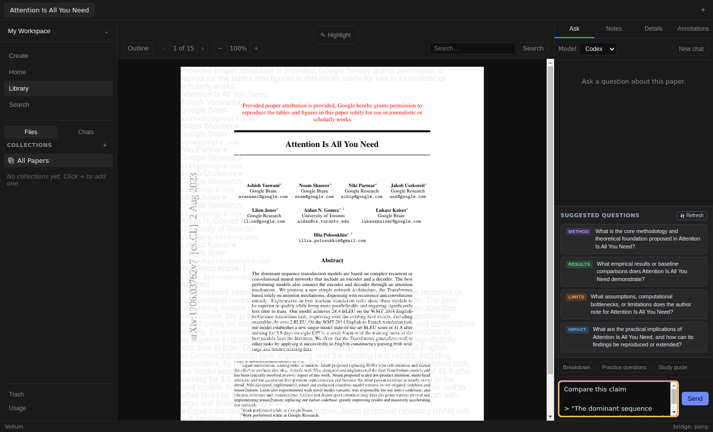
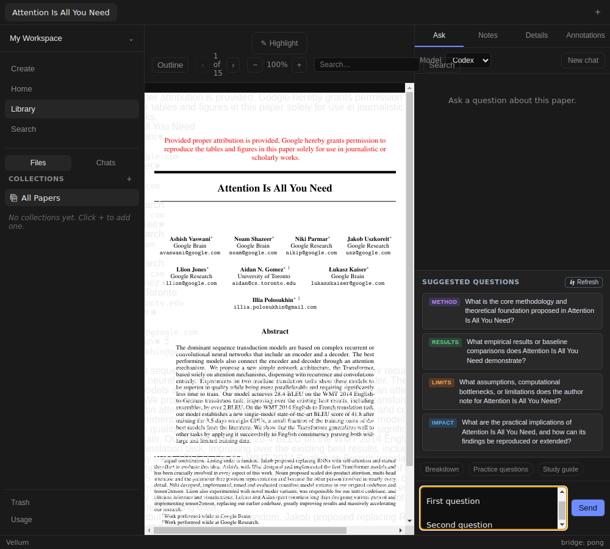
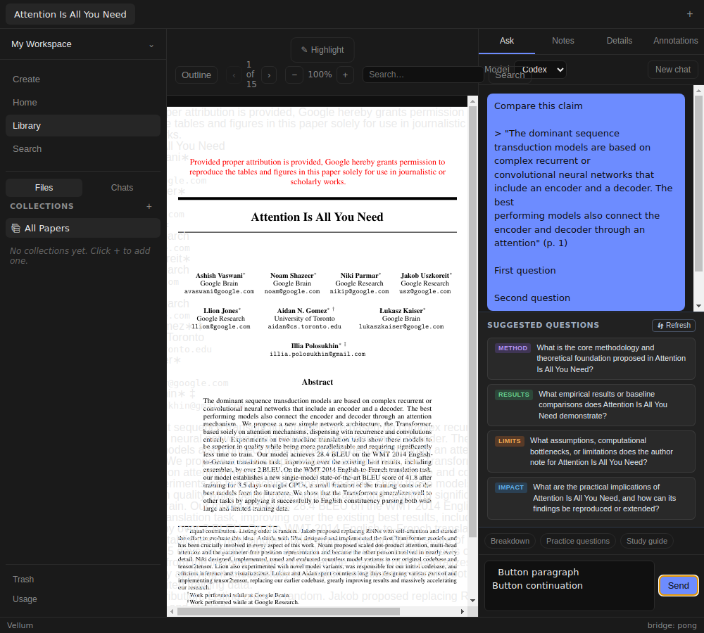
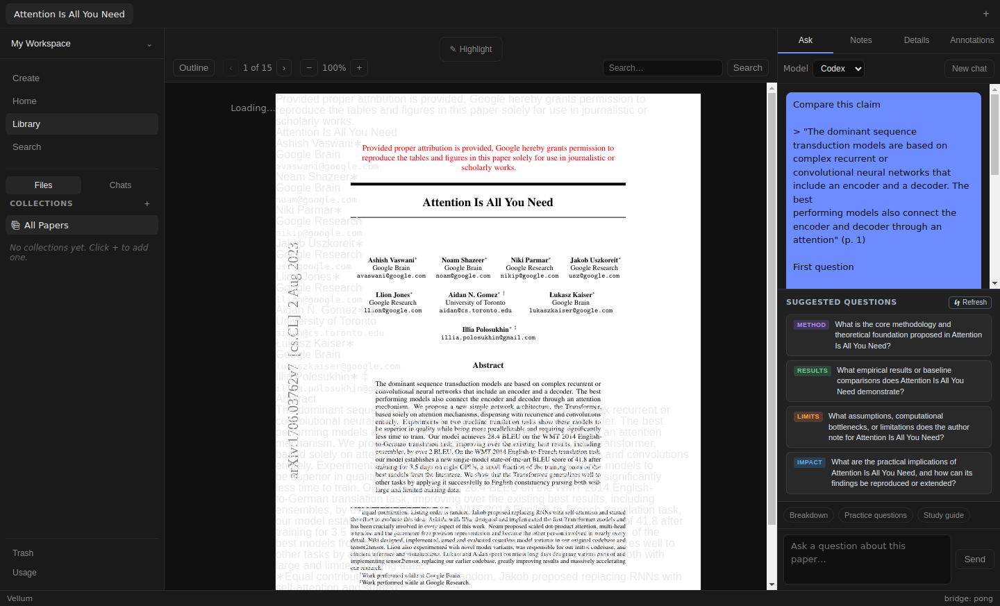

# Issue #183 verification

Pinned base #152 `0d72bd79f5eaf79adec10f28a6aea44d296c113f`, verified 2026-11-06.
Target `fix/149-navigation-error-banner-602cb113`. Stack #152/#150/#146/#126/#97.

## Change and red-green proof

Ask composer uses a three-row textarea with existing label, focus, value, Send,
and outer trim. Interior newlines remain intact. Enter requests form submission;
Shift+Enter uses native textarea newline behavior. Composition ref, native
isComposing, and keyCode 229 prevent composition/commit Enter submission.
Repeated keydown cannot send. Existing request/session ownership remains intact.
No backend, schema, dependencies, Reader, or layout redesign changes.

Before production edits, two component cases fail on visible injected text with
and without subsequent editing. Actual Chromium independently shows both visible
and submitted text as `Compare this claim> "Line oneLine two" (p. 2)`, losing
both draft boundary and quote newline, even without editing. Green Chromium
retains `Compare this claim\n\n> "Line one\nLine two" (p. 2)` and edited suffix.
No browser page errors in either phase. Original investigation remains at
`/tmp/vellum-ask-multiline-repro/`; fresh current-checkout browser harness and
red/green JSON/logs at `/tmp/vellum183-browser/`.

- Multiline red: `/tmp/vellum183-red.log`, 2 fail, 31 existing pass.
- Textarea green: `/tmp/vellum183-multiline-green.log`, 33 pass.
- Keyboard red before handler: `/tmp/vellum183-keyboard-red.log`, 3 fail, 33 pass.
- Focused green: `/tmp/vellum183-green.log`, 36 pass.
- Final full `npm test`: 41 files, 447 tests pass, `/tmp/vellum183-tests.log`.
- Typecheck/build/diff check pass. Logs `/tmp/vellum183-typecheck.log` and
  `/tmp/vellum183-build.log`. No lint script exists.

Five added component cases cover paragraphs, once-only Enter, empty/repeat guards,
composition/commit events, and injected quote preservation before/after editing.
Existing tests retain Explain auto-send, quick/suggested prompts, disabled states,
loading/failure recovery, session changes, deletion and request ownership.
Typecheck initially caught two test-only Playwright `exact` options copied into
Testing Library calls; removed, then all checks rerun successfully.

## Isolated Electron proof

[Live harness](issue-183/live.mjs) launches installed Electron through Playwright
under Xvfb. Uses isolated VELLUM_DATA_DIR, user profile, SQLite and paper files.
Seeds Attention Is All You Need metadata and extracted markdown from real PDF,
2,215,244 bytes. Seeded empty Codex chat. Ingest is not exercised.
Temporary main-bundle copy replaces only ACP session transport with controlled
success/error events and captures parsed ask-start requests. Production renderer,
preload, IPC validation, ChatManager, SQLite and PDF.js remain real. Bundle copy
removed on exit. No signed-in ACP, credentials or model calls.

Built run `/tmp/vellum183-live-H3gc6f/`, output `/tmp/vellum183-live.log`.
Development run `/tmp/vellum183-live-CwHfUr/`, output `/tmp/vellum183-live-dev.log`.
Development renderer started with `npm run dev -- --rendererOnly --noSandbox`
under Xvfb and isolated config/data; `/tmp/vellum183-dev.log`. Initial launch
without DISPLAY failed; Xvfb run passed. Shared preview unavailable; open returned
`net::ERR_CONNECTION_REFUSED`. No preview tab remained open.

Actual mouse drag across three PDF.js abstract lines creates native selection.
Click Add to chat, verify focus and exact draft plus quote, native type paragraphs
with Shift+Enter, press Enter. Captured request retains selection line breaks,
draft separators and added paragraphs exactly, one request only. Next native
paragraph turn uses Send, retaining interior newline and trimming outer spaces.
Tab reaches Send. Held transport confirms disabled composer/New chat and Sending.
Injected transport error appears inline; subsequent multiline Enter recovers.
Restart reopens paper through Library. Actual askOpen returns exactly identical
persisted messages, including every user newline; visible user messages checked.
[Recorded requests/history/geometry](issue-183/live-result.json).

At 1440×900 and 1000×900, textarea is 241.625×72.5 inside 320×89.5 composer row.
Textarea/Send stay within viewport; no document overflow. Three rows scroll longer
content. Labels, injection focus, Tab focus, empty/busy/error states checked.
Screenshots visually inspected. Renderer errors/warnings/page errors: none in
built or development runs. Main stderr has headless GPU/DBus/debugger diagnostics.

## Review and limits

Local standards/spec self-review against pinned base and full #183 contract:
no remaining findings. Checked DOM value versus React state, native default
behavior, composition event ordering/229 fallback, once-only request ownership,
trim boundaries, bounded CSS, renderer isolation and scope. No subagents or
independent review. Missing `docs/agents/issue-tracker.md`; fetched issue with gh.

Native SQLite binding privately backed up, rebuilt for Electron, then restored
byte-for-byte. No Node tests overlapped rebuild. Restored Node in-memory DB opens.
SHA-256 `45cb92a176fb758533db6d9a343acdfc73e4de27ac4c20a0cb2a6fb5be3e84f2`.
Parent checkout and bindings untouched. Temporary dev/Electron processes stopped.

Real OS IME unverified: IBus executable exists but `ibus list-engine` reports
`Can't connect to IBus.` Component composition/commit events pass. No signed-in
ACP, answer quality, macOS/Windows or packaged-app claim. Deterministic transport
proves UI requests/persistence, not backend grounding. Existing selection toolbar
#155 and Reader stack limitations remain separate. Screenshots show existing PDF
text overlap #86, narrow Reader toolbar overflow #151, and transient loading
state #148. No Reader fixes included. Independent live review remains required;
issue stays in-progress and PR draft. No merge, watch, labels or phase unlock.
