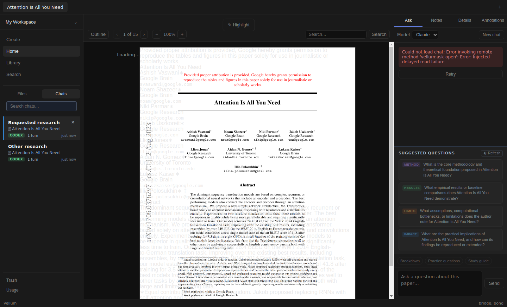
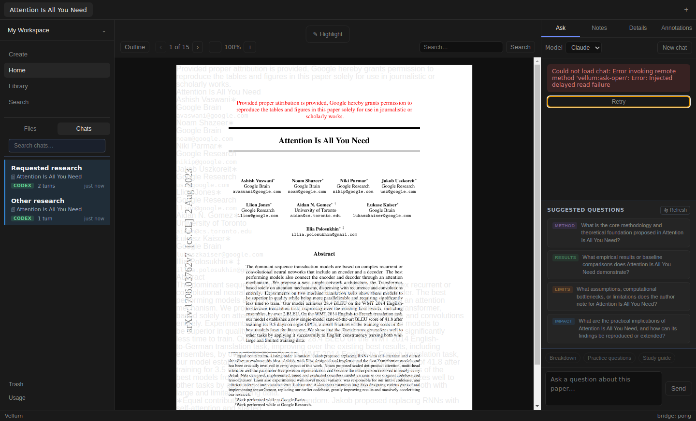
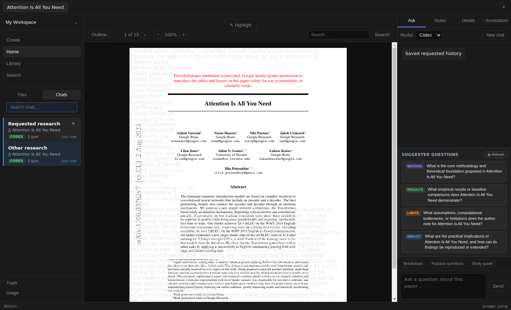
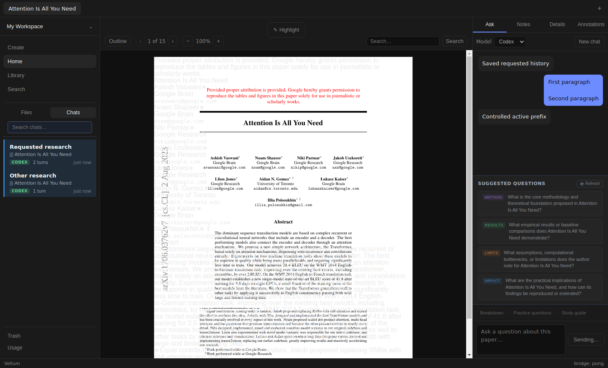
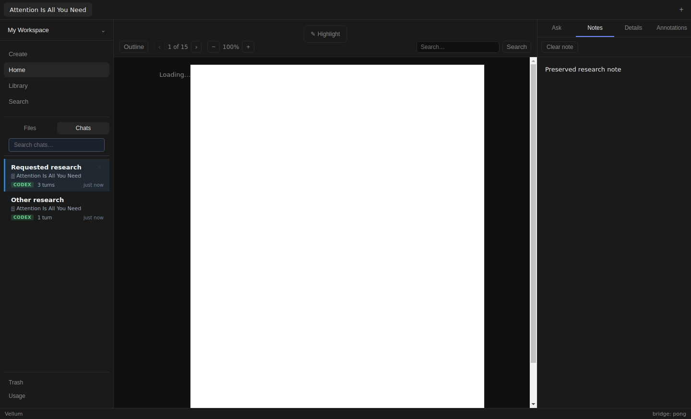

# Issue #185 verification

Base #184 `ab89321fac18029b5caefcfbf75c87f3e1d85721`, verified 2026-11-06.
Target `fix/183-multiline-composer`, above #152/#150/#146/#126/#97.

## Behavior and regression

Failed requested-chat open now exposes native Retry button beside alert. Retry
increments load revision, rerunning existing load effect with same paper and
requested session. Pending retry removes Retry and shows Loading chat status.
Composer/New chat remain disabled until successful idle snapshot. Repeated
failures expose Retry again. Existing generation cancellation, deleted-session
refresh, active-turn snapshot/sequence replay and prompt injection remain owners.
No new chat, automatic retry, backend/schema or CSS changes.

Public AskPanel regression failed before production edit: Retry absent, 36 prior
tests pass. Red log `/tmp/vellum185-red.log`; original supplied proof remains
`/tmp/vellum-ask-open-repro/`. First green `/tmp/vellum185-green.log` has 37 tests.
Final focused suite has 45 tests. Nine new cases cover repeated failure and
keyboard activation, exact requested session/history, no fresh conversation,
active-turn snapshot/newer-event replay, pending Add to chat/Explain and multiline
submission, stale success/error after same-paper session or cross-paper switch
and revisit, and deleted requested snapshot refresh.

Final checks pass:

- `npm test -- src/app/AskPanel.test.tsx`: 45 tests.
- `npm test`: 41 files, 456 tests.
- `npm run typecheck`.
- `npm run build`.
- `git diff --check`.

Logs `/tmp/vellum185-focused.log`, `/tmp/vellum185-tests.log`,
`/tmp/vellum185-typecheck.log`, `/tmp/vellum185-build.log`.

## Real-paper Electron flow

[Reproducible harness](issue-185/live.mjs), [built results](issue-185/live-result.json).
Playwright Electron under Xvfb. Private data/profile, real Attention Is All You
Need PDF, 2,215,244 bytes, extracted markdown. Metadata, two saved conversations
and note seeded through compiled repository functions. Ingest not exercised.
Production renderer/preload/main/ChatManager/SQLite/PDF.js exercised.

Temporary compiled main copy instruments only these boundaries:

1. ask-open records original argument, optionally waits on controlled promise,
   then either rejects with `Injected delayed read failure` or runs real handler.
2. ACP newSession returns deterministic async prompt yielding prefix, waiting,
   then yielding suffix/done. No process, model, credentials or personal settings.
3. ask-start records parsed argument. Startup seeds private paper/history/note.

Built run `/tmp/vellum185-live-uAQaq4`, log `/tmp/vellum185-live.log`.
Development run `/tmp/vellum185-live-0fFW9q`, log `/tmp/vellum185-live-dev.log`.
Development renderer served by `npm run dev -- --rendererOnly --noSandbox`
under Xvfb with private state/profile. Harness selects server via
`VELLUM_185_RENDERER_URL=http://localhost:5173`. StrictMode makes two mount opens;
harness releases both canceled/current promises, then asserts all four initial
open/retry arguments target requested session. Built run asserts exactly three.
First harness attempt used button locator for Chats, which is a tab. First dev
attempt released only canceled StrictMode open. Both harness issues corrected;
final runs above pass. Shared preview unavailable: open returned
`net::ERR_CONNECTION_REFUSED`. No preview tab remained.

Visible journey:

1. Chats tab, Requested research. Hold initial open; inspect Loading chat and
   disabled composer. Reject. Inspect alert, enabled Retry, disabled chat controls.
2. Native Tab traversal reaches Retry; native Enter retries. Reject again, repeat
   keyboard activation, release successfully. Correct saved history and Codex
   backend return. Two conversations remain; no recovery-created conversation.
3. Native text typing and Shift+Enter create two paragraphs. Send captures exactly
   `First paragraph\n\nSecond paragraph`, outer spaces trimmed, one request.
4. Hold real ChatManager turn after streamed prefix. Notes tab shows saved note.
   Ask remount open fails. Retry restores real main-process active-turn snapshot,
   prefix and busy controls. Release transport; suffix/final persisted answer
   appears and composer unlocks. Starts count remains one. Active-turn state is
   real, driven by controlled transport; queued sequence replay also has component
   coverage, not a separately injected live event race.
5. Hold another retry. Navigate Other research, then Requested research; type
   destination draft. Release stale retry. Current draft/history stay intact.
   Live navigation covers same-paper sessions. Cross-paper stale success/error
   and stale rejection are covered by component tests.
6. Restart Electron process, reopen requested chat. Exact persisted history and
   multiline user text match. Note matches. PDF/markdown SHA-256 unchanged.

Loading/error/recovery/busy states, labels, Retry Tab/Enter focus, disabled empty
composer Send and restart checked. Existing empty-history message covered by
component tests; no new empty chat created during recovery. Screenshots inspected
at default 1440px width. No new responsive layout claim.

Renderer warning/error/pageerror capture: none in final built or dev run. Main
stderr includes expected injected IPC rejection stacks, headless GPU initialization,
DBus and debugger diagnostics. Existing PDF text overlap #86 and loading overlay
#148 visible in screenshots; no Reader fixes included.

## Binding, review and limits

Dependencies installed privately in prepared checkout. Private Node SQLite binding
backed up, rebuilt for Electron, then restored exactly before Node checks.
`cmp` and in-memory Node query pass. SHA-256
`45cb92a176fb758533db6d9a343acdfc73e4de27ac4c20a0cb2a6fb5be3e84f2`.
No Node tests overlapped binding rebuild or live Electron. Parent checkout/binding
untouched. Dev/Electron processes stopped; temporary instrumented bundle removed.

Local standards and spec self-review against pinned #184 and #185 contract found
no remaining findings. Examined generation cleanup, identical requested argument,
delete refresh, stream replay, pending injection, keyboard behavior, renderer
isolation and focused diff. No subagents per instruction. Independent review
unverified. Missing `docs/agents/issue-tracker.md`; issue fetched through gh.

Natural SQLite/storage faults unverified; explicit delayed IPC faults only.
Deterministic transport does not verify signed-in ACP, model answers or grounding.
OS IME unverified; inherited composition-event regression passes. No macOS,
Windows, packaged-app, screen-reader or automated contrast certification.
No merge, watch, labels or dependency unlock. Issue remains in-progress, PR draft.
